# Teachers' feedback, round 2

Collected 2026-10-18, with the developer's comments and the decisions that followed. The work items are in [docs/tasks/](../tasks/README.md).

## 1. What the teachers asked for

### Voice

- The voice sounds too much like an AI.
- They first asked for a child's voice with a Northern accent. That is not feasible, so the request was lowered to **a Northern-accent voice** as the default.

### Games and names

- **Merge the first and the sixth game** (Cái cân and So sánh cân). Which part comes up is chosen randomly or in sequence. The merged game is called **"Thăng bằng"**.
- **Rename** Giỏ trái cây to **"Chia quả"** and Tính theo hình to **"Giải mã hình"**.
- **Add a new game, "Quy luật"** (patterns).

### Phones

- Allow access from phones. The reference sizes are **iPhone 15** and **iPhone 15 Pro Max**.
- The teachers report that the site does not recognise a phone even in landscape.

### New pictures

New tile art and a new Mèo:

| | |
|---|---|
| Mèo Smarty |  |
| Thăng bằng | 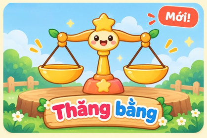 |
| Rô-bốt | 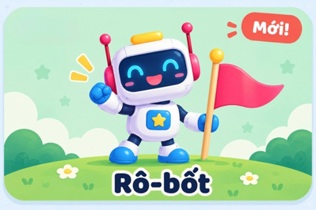 |
| Chia quả | 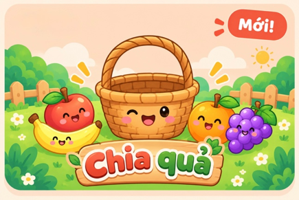 |
| Giải mã hình | 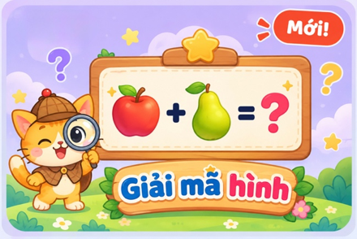 |
| Mấy và mấy | 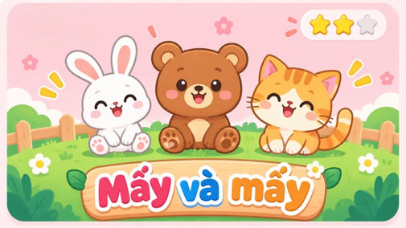 |
| Quy luật | 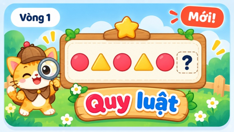 |

### Mechanics: one game at a time

- A child must finish one game before starting another.
- The teacher sets how many game types a child can open per day (3–4 as the default).
- The other games in the panel are greyed out and locked, with messages such as:
  - "Trò này sẽ mở vào hôm khác nhé!"
  - "Bé hoàn thành trò trước đã nhé!"

### Giải mã hình

- The game is a bit too easy.
- Vòng 1 can be harder, with more operations and several symbols at once, forward only. Example: cam = 1, táo = 2, chuối = 0; cam + táo = ?; chuối + táo = ?; cam + táo + chuối = ?.
- In Vòng 2 and 3, no two fruits have the same number.

### Thăng bằng (needs a rework)

| Teacher's stage | Content |
|---|---|
| Vòng 1 | The old game: move fruit onto the scale to make it level. |
| Vòng 2 | Pick the lightest or heaviest box. |
| Vòng 3 | Arrange the boxes in ascending or descending order. |
| Vòng 4 | Inference, the same idea as Giải mã hình. Two clue scales are shown; the child puts fruit on the empty third scale to balance it. Only one chain of reasoning. |
| Vòng 5 | Inference with two chains of reasoning. |

Reference worksheets:

- One chain: 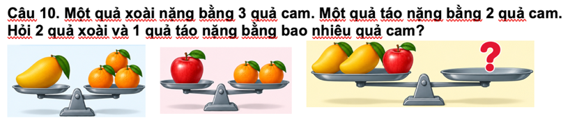
- Two chains: 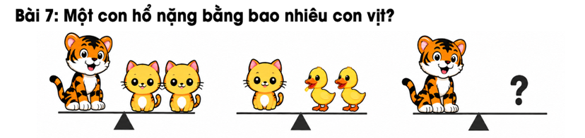

### Chia quả (needs a rework)

- **Vòng 4, inference by subtraction:** "Trong giỏ của Mèo có 5 quả táo. Mèo muốn có tất cả 15 quả táo. Hỏi Mèo cần nhặt thêm bao nhiêu quả táo nữa?"
- **Vòng 5, comparing the two baskets:** "Giỏ của em có 16 quả táo, giỏ của Mèo có 2 quả táo. Em hãy chuyển một số quả táo từ giỏ của mình sang giỏ của Mèo để hai giỏ có số táo bằng nhau. Hỏi em cần chuyển bao nhiêu quả táo?" An alternative to "equal": "Để Mèo có nhiều hơn em 2 quả táo?"

### Mấy và mấy

- Better pictures than plain flowers. The teachers suggest a white rabbit and a brown rabbit in a garden with trees and flowers.

### Quy luật (new game)

Reference worksheets:

- 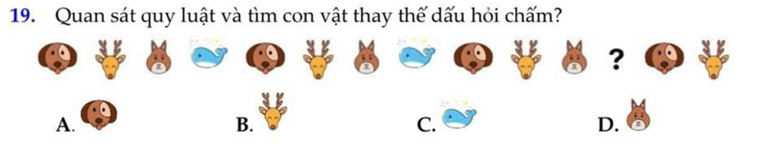
- 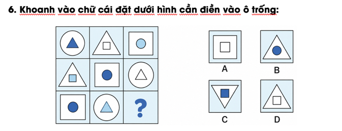
- 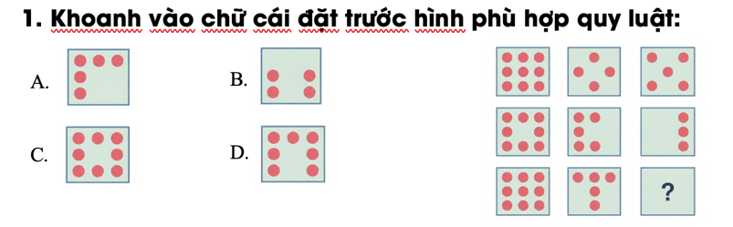
- 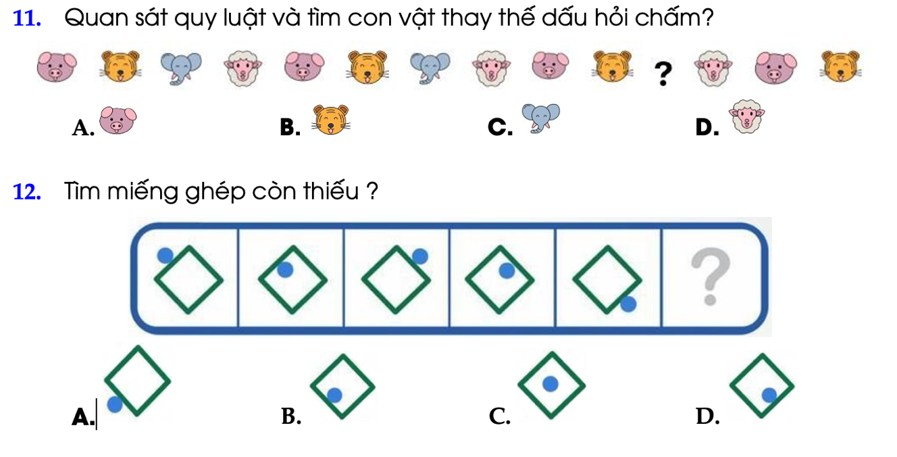

## 2. The developer's notes

- **Phones.** The developer does not like children using phones this way, since it makes a worse experience. Phone access is still needed because the teachers want it.
- **Tile art.** The new pictures suggest the tiles can be more artistic and more dynamic.
- **Quy luật.** The reference puzzles feel arbitrary, like IQ tests, and this kind of puzzle may not be reliably generated or checked by code.
- **Animals.** The "no animals" rule is the developer's own, not the teachers'. The reasons are safety and neutrality: a child might be afraid of a particular animal; animals moving between baskets are not realistic; and realistic animal pictures are tied to barriers, fences and cages. Animals in a garden are fine.

## 3. Decisions (2026-10-18)

1. **Games.** There are still six tiles in a 3×2 grid: Thăng bằng, Rô-bốt, Chia quả, Giải mã hình, Mấy và mấy, Quy luật. The game id `compare` goes away; `pattern` is added. See [task 02](../tasks/02-thang-bang.md) and [task 03](../tasks/03-quy-luat.md).
2. **Three visible rounds.** The teachers' Vòng 4 and 5 become hidden steps inside Vòng 3. Reaching a fifth visible round would take about 12 good days.
3. **Animals** are allowed, but only free in a garden or open nature: no cages, no fences, nothing carried between baskets, nothing scary. The two kinds in a picture differ by shape, not only colour, and motion is not used to tell them apart. The garden is a faded background. See [task 06](../tasks/06-may-va-may-garden.md).
4. **Phones** work in landscape with a wide layout; portrait still shows the "turn sideways" notice. The cause of the block is our own rule (a screen under 420 px is treated as a phone). See [task 08](../tasks/08-phone.md).
5. **Daily plan.** "Finishing a game" means one set of 5. The teacher sets how many games a child plays per day. The day's games are the least recently played, in warm-up order (lowest level first, so progress stays even) or random order. A game left half-way keeps the others locked. A finished game can be replayed for no credit. See [task 04](../tasks/04-daily-plan.md).
6. **Giải mã hình.** Vòng 1 gets several rows per question; every fruit has its own value. See [task 01](../tasks/01-giai-ma-hinh.md).
7. **Chia quả.** The "need N more" and "make the baskets equal" levels are added. "Mèo has 2 more than you" is left out for now (too hard in October). See [task 05](../tasks/05-chia-qua.md).
8. **Quy luật.** Only puzzles with exactly one answer: repeating rows with at least two full cycles, a moving dot, number rows and a 3×3 grid. The dot-grid kind is dropped. See [task 03](../tasks/03-quy-luat.md).
9. **Voice.** The Nam Minh pack (Northern) becomes the default. See [task 09](../tasks/09-voice.md).
10. **Art.** The teachers' pictures are style references. The tiles are rebuilt in HTML, CSS and SVG, with swaying leaves, drifting clouds and twinkling sparkles. Mèo is redrawn in SVG. See [task 07](../tasks/07-art.md).
11. **Desktop builds.** Three Tauri builds: 16:9, iPad and iPhone 15. See [task 11](../tasks/11-tauri-sizes.md).
