# Thám tử Toán học Tí hon: Hướng dẫn sử dụng

*Dành cho giáo viên và phụ huynh của học sinh lớp 1*

[English](USER_GUIDE.md)

## Mục lục

- [1. Ứng dụng này là gì?](#1-ứng-dụng-này-là-gì)
- [2. Mở ứng dụng](#2-mở-ứng-dụng)
- [3. Mỗi em một hồ sơ](#3-mỗi-em-một-hồ-sơ)
- [4. Trang chủ](#4-trang-chủ)
- [5. Một vụ án (một lượt chơi)](#5-một-vụ-án-một-lượt-chơi)
- [6. Sáu trò chơi](#6-sáu-trò-chơi)
   - [Cái cân](#cái-cân)
   - [Rô-bốt](#rô-bốt)
   - [Giỏ trái cây](#giỏ-trái-cây)
   - [Tính theo hình](#tính-theo-hình)
   - [Mấy và mấy](#mấy-và-mấy)
   - [So sánh cân](#so-sánh-cân)
- [7. Nút hướng dẫn (i) và "Mèo làm mẫu"](#7-nút-hướng-dẫn-i-và-mèo-làm-mẫu)
- [8. Ba Vòng và độ khó tự điều chỉnh](#8-ba-vòng-và-độ-khó-tự-điều-chỉnh)
- [9. Sao và chuỗi ngày](#9-sao-và-chuỗi-ngày)
- [10. Thời gian chơi lành mạnh](#10-thời-gian-chơi-lành-mạnh)
- [11. Khu vực giáo viên](#11-khu-vực-giáo-viên)
- [12. Giọng nói của Mèo (thu âm)](#12-giọng-nói-của-mèo-thu-âm)
- [13. Gặp sự cố?](#13-gặp-sự-cố)

## 1. Ứng dụng này là gì?

**Thám tử Toán học Tí hon** là bộ sáu trò chơi toán nhỏ cho học sinh lớp 1 (6 tuổi). Các em cùng chú mèo thám tử **Mèo Smarty** giải các "vụ án": mỗi vụ án là một bộ 5 câu hỏi toán ngắn.

- Sáu trò chơi: **Cái cân**, **Rô-bốt**, **Giỏ trái cây**, **Tính theo hình**, **Mấy và mấy**, **So sánh cân**. Cùng luyện đếm, cảm nhận về số, cộng trừ trong phạm vi 10 (về sau 20) và tư duy logic đầu tiên.
- Theo chương trình **2018** (Kết nối tri thức), bắt đầu từ các số 0–10.
- Mọi lời nói và chữ trên màn hình dành cho các em đều bằng **tiếng Việt**, được Mèo Smarty **đọc to** vì các em còn đang học đọc.
- **Không cần mạng** sau lần mở đầu tiên, **không cần tài khoản**. Tiến trình lưu ngay trên thiết bị.
- Độ khó **tự điều chỉnh** theo từng em (ba "Vòng"), có sao thưởng, chuỗi ngày chơi, giới hạn thời gian và khu vực riêng cho người lớn.

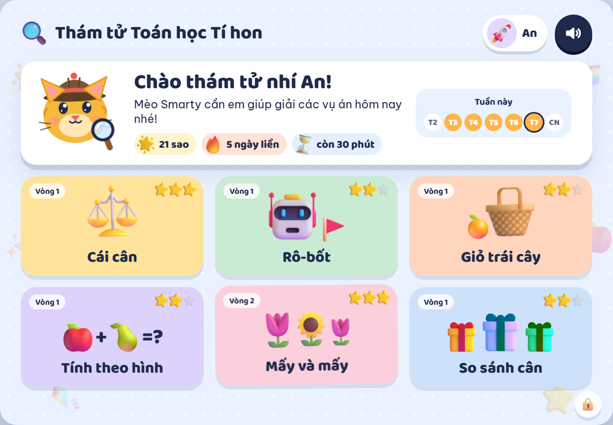
*Trang chủ: sáu trò chơi, sao, chuỗi ngày và thời gian còn lại.*

## 2. Mở ứng dụng

Ứng dụng chạy trên **máy tính bảng đặt ngang** (iPad) hoặc **máy tính**. Khi để dọc hoặc trên điện thoại, màn hình sẽ nhắc "Em hãy xoay ngang máy".

#### Cách 1: mở trong trình duyệt

Mở địa chỉ trang web do nhà trường cung cấp. Lần đầu cần có mạng để tải; từ lần sau ứng dụng mở được cả khi không có mạng.

#### Cách 2: cài lên màn hình chính của iPad (nên dùng)

1. Mở trang trong **Safari**.
2. Chạm nút **Chia sẻ** (hình ô vuông có mũi tên lên).
3. Chọn **"Thêm vào Màn hình chính"**.
4. Mở ứng dụng từ biểu tượng Mèo Smarty trên màn hình chính, một lần khi có mạng.

> 💡 Cài lên màn hình chính cũng giúp **giữ dữ liệu**: Safari có thể tự xoá dữ liệu của trang web không dùng trong 7 ngày, nhưng không xoá dữ liệu của ứng dụng đã cài. Dù vậy hãy **sao lưu** định kỳ (xem phần Khu vực giáo viên).

#### Cách 3: ứng dụng cho Windows

Có bản cài đặt cho Windows (tệp `.exe`), chạy trong cửa sổ riêng như một phần mềm bình thường, không cần trình duyệt hay mạng. Nhờ người cài đặt chạy `npm run desktop:build` hoặc dùng tệp đã được build sẵn.

## 3. Mỗi em một hồ sơ

Nhiều em có thể dùng chung một thiết bị. Khi mở ứng dụng, mỗi em chạm vào **hình đại diện** của mình, không cần mật khẩu. Sao, chuỗi ngày, độ khó và thời gian đã chơi được lưu **riêng cho từng em**.

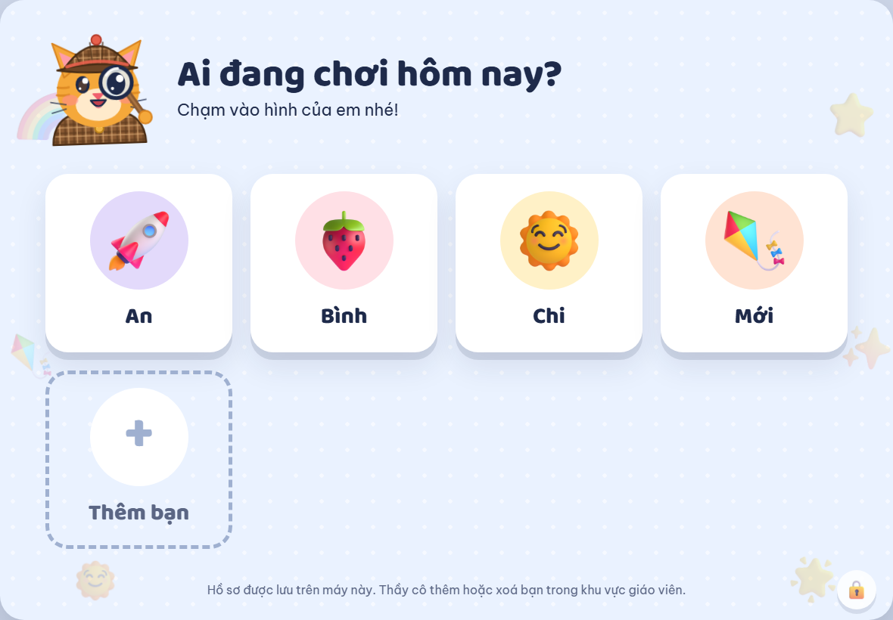
*Màn hình "Ai đang chơi hôm nay?".*

Lần đầu mở, ứng dụng mở sẵn mẫu **"Thêm bạn mới"**: gõ tên và chọn một hình. Giáo viên cũng có thể thêm, đổi tên hoặc xoá bạn trong **Khu vực giáo viên**.

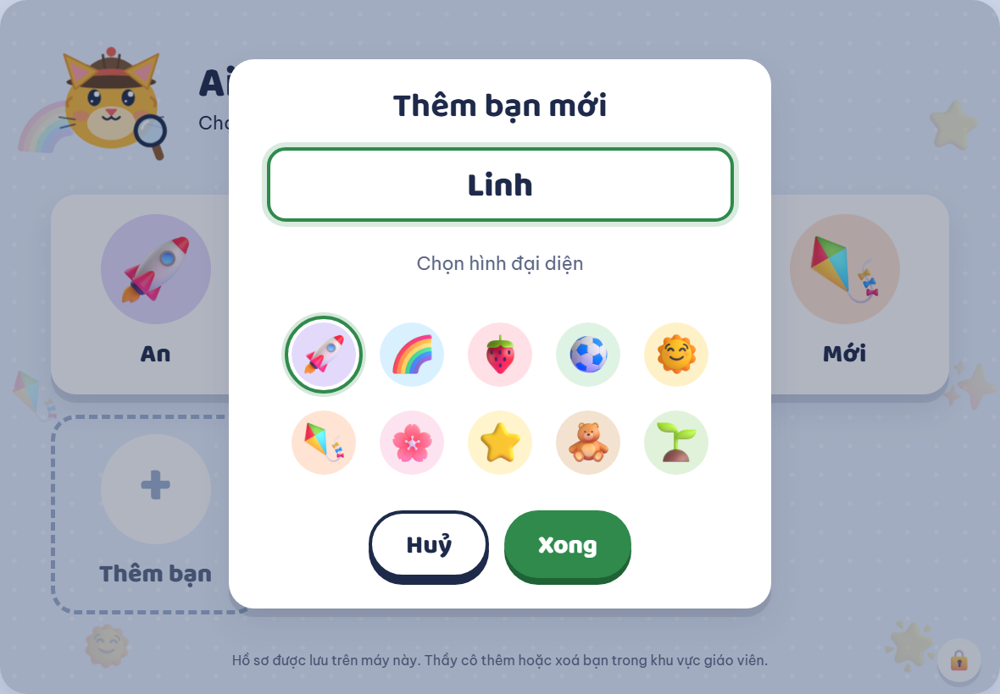
*Thêm một bạn mới: tên và hình đại diện.*

## 4. Trang chủ

- Mèo Smarty chào em bằng tên.
- **Tổng số sao** em đã được, **chuỗi ngày** chơi liền nhau, và **thời gian còn lại** hôm nay.
- **Tuần này**: những ngày em đã có sao, hôm nay và những ngày còn lại.
- **Sáu ô tranh**: chạm vào một ô để bắt đầu một vụ án. Mỗi ô ghi **Vòng** em đang ở; ô có chữ "Mới!" là trò em chưa chơi, ô đã chơi hiện **số sao tốt nhất**.
- **Nút loa** (góc trên): bật hoặc tắt tiếng. Đây là **cài đặt duy nhất** em có thể tự đổi.
- **Ổ khoá nhỏ** ở góc dưới bên phải dành cho người lớn: **giữ khoảng 1 giây** để vào Khu vực giáo viên (cần mã PIN).

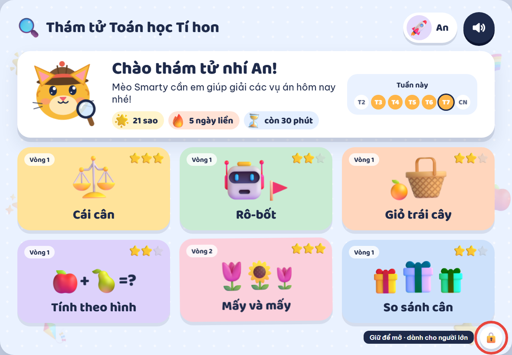
*Ổ khoá (khoanh đỏ) ở góc dưới bên phải: giữ khoảng 1 giây. Chạm nhanh chỉ hiện lời nhắc.*

## 5. Một vụ án (một lượt chơi)

- Một lượt chơi là **bộ 5 câu hỏi** trong một trò chơi. Năm chấm tròn ở trên cho biết em đã làm đến đâu, bên cạnh là **Vòng** hiện tại.
- Mỗi câu được Mèo Smarty **đọc to**; chữ hiện trên màn hình. Nút loa nhỏ cạnh câu hỏi dùng để **nghe lại**.
- Mọi thao tác kéo thả đều có cách **chạm**: chạm vào vật, rồi chạm vào nơi muốn đặt.
- Em làm xong thì chạm nút xanh **"Xong"** (hoặc "Chạy!" ở trò Rô-bốt).
- Nút mũi tên tròn ở góc trên bên trái để quay về trang chủ. Rời giữa chừng thì lượt chơi dở đó **không được lưu**.

#### Khi em trả lời sai

1. Mèo Smarty nói nhẹ nhàng: "Gần đúng rồi!" và đưa ra **gợi ý**, không có dấu X đỏ hay âm thanh đáng sợ.
2. Em được **thử thêm một lần**.
3. Nếu vẫn chưa đúng, Mèo **cho xem đáp án** rồi sang câu tiếp.
4. Chỉ **lần thử đầu tiên** được tính điểm; lần thử lại là để học.

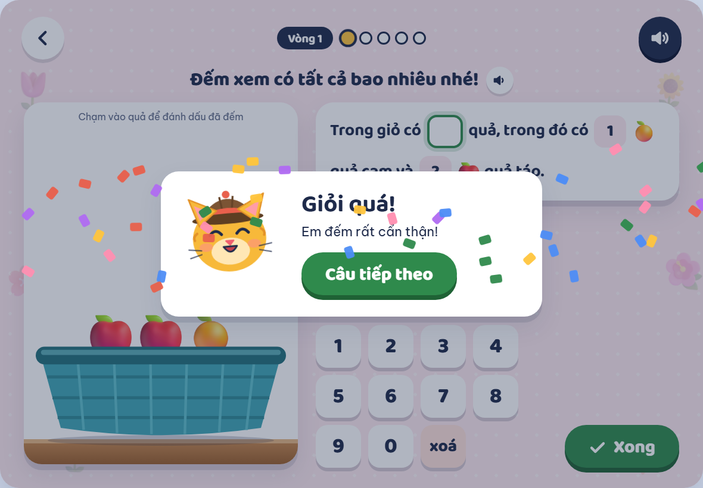 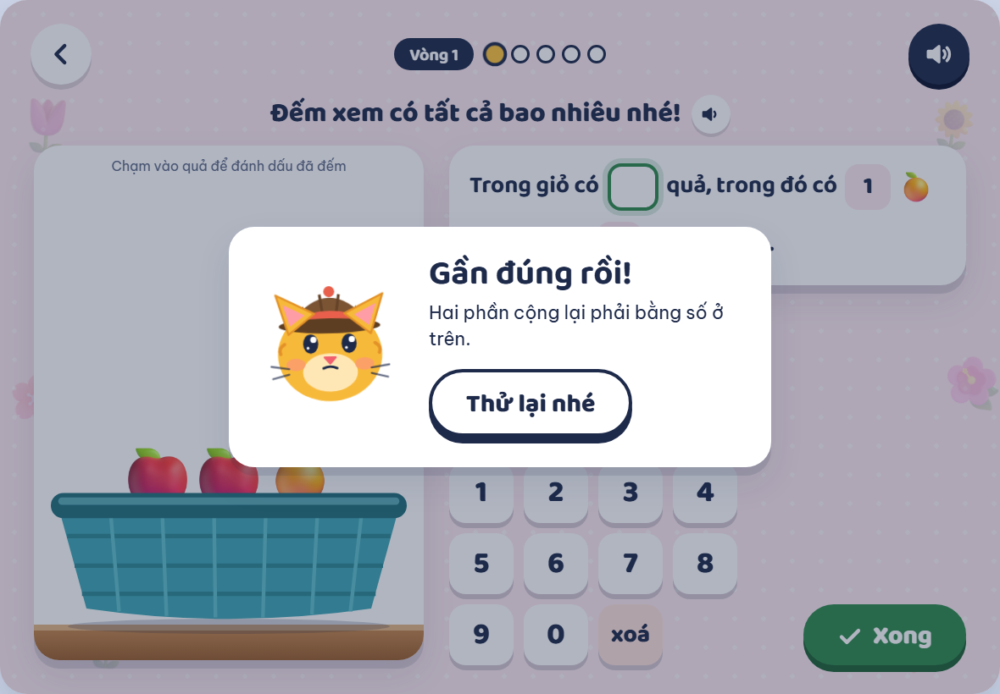

*Đúng: lời khen và pháo giấy. Sai: gợi ý nhẹ nhàng và thử lại.*

## 6. Sáu trò chơi

Mỗi trò có ba **Vòng** (1, 2, 3). Dưới đây là mỗi trò dạy gì, chơi thế nào và các Vòng khác nhau ra sao. Ảnh bên trái là Vòng 1; ảnh bên phải là một Vòng cao hơn.

### Cái cân

**Dạy gì:** "bằng nhau" nghĩa là *tổng cân nặng bằng nhau*, không nhất thiết số lượng bằng nhau; bước đầu của phép cộng và so sánh.

- Hai đĩa cân, mỗi đĩa có sẵn vài quả. Em **kéo quả từ khay phía dưới vào đĩa** (hoặc chạm quả rồi chạm đĩa) cho **hai đĩa nặng bằng nhau**, rồi chạm "Xong".
- **Cân nặng** (luôn có bảng "Bảng cân" trên màn hình): nho = 1, táo = 2, dưa hấu = 3.
- **Vòng 1:** một loại quả; cân **nghiêng ngay** khi thêm quả, mỗi đĩa hiện số quả và có dấu **>, < hoặc =** trên trục cân.
- **Vòng 2:** hai loại quả và bảng cân; một **ổ khoá giữ cân thăng bằng** cho đến khi em chạm "Xong".
- **Vòng 3:** ba loại quả (nho 1, táo 2, dưa hấu 3).
- Đáp án đúng khi **tổng cân nặng hai bên bằng nhau**; có nhiều cách xếp đúng.

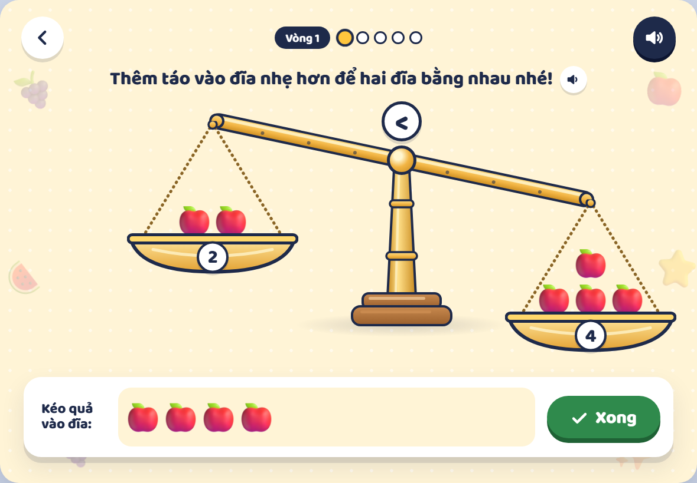 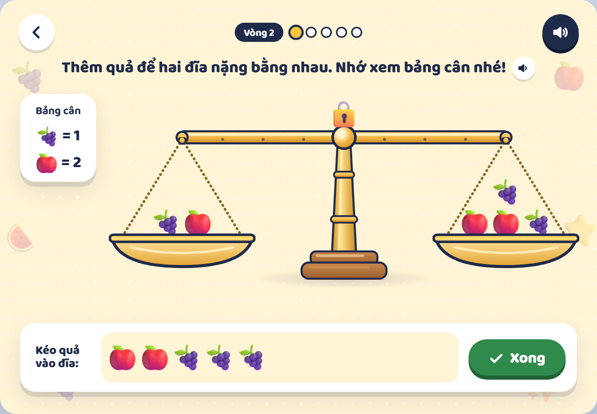

*Cái cân: Vòng 1 (trái) và Vòng 2 (phải).*

### Rô-bốt

**Dạy gì:** xếp các bước theo thứ tự (lập trình đầu tiên), phương hướng, đếm ô và tránh vật cản.

- Em chạm các **mũi tên** (lên, xuống, trái, phải) để xếp **từng bước đi** cho rô-bốt; mỗi mũi tên là **một ô**. Tối đa 12 bước.
- Chạm **bước cuối cùng** để lấy lại nó (xoá một bước), hoặc **"Làm lại"** để xếp lại từ đầu.
- Bấm **"Chạy!"** để xem rô-bốt đi đúng các bước đã xếp. Nếu tới lá cờ: đúng. Nếu đụng tường hay ô gạch, rô-bốt lắc và quay về chỗ xuất phát để em sửa.
- **Vòng 1:** bảng 4 × 4 trống, đường ngắn. **Vòng 2:** có **tường đỏ** giữa các ô và **ô gạch** không đi qua được. **Vòng 3:** bảng lớn hơn, đường dài hơn, nhiều vật cản hơn.
- Các màn chơi do máy tạo ra và luôn có ít nhất một đường đi.

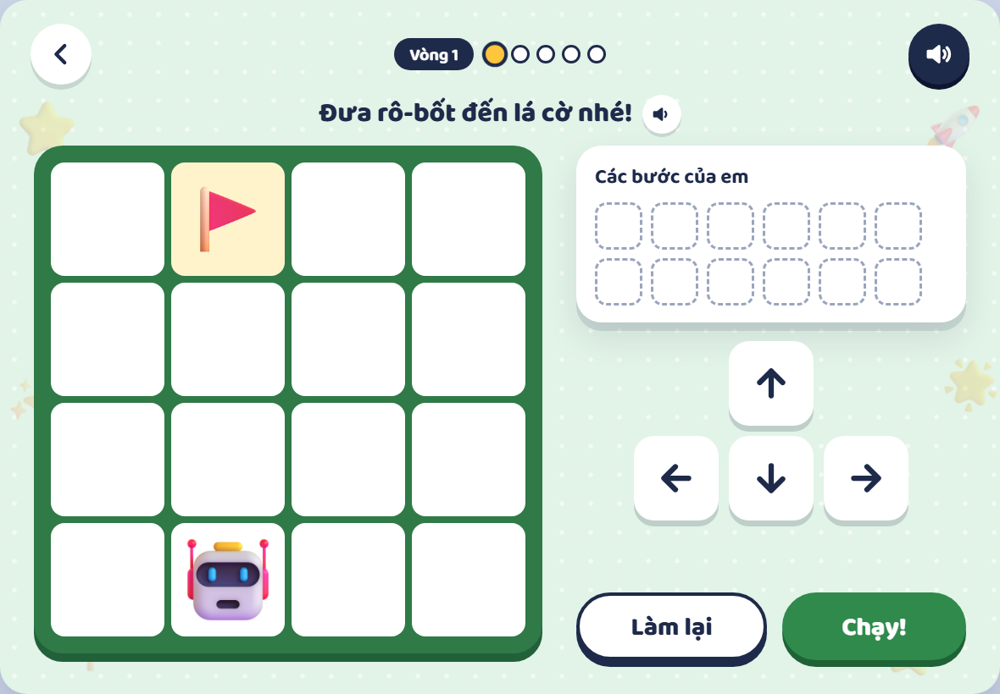 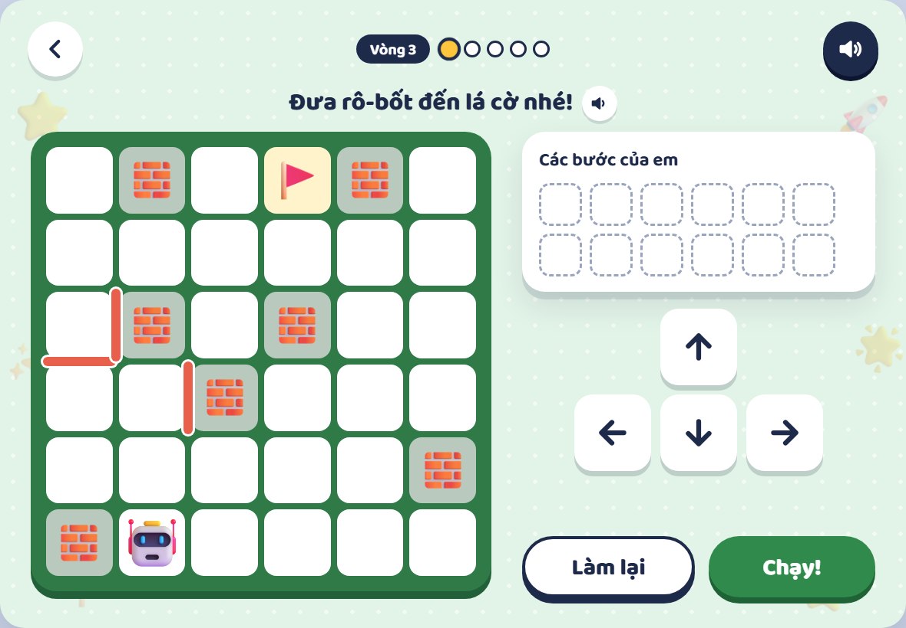

*Rô-bốt: Vòng 1 (trái) và Vòng 3 (phải).*

### Giỏ trái cây

**Dạy gì:** đếm chính xác, so số với số lượng, và **chục**: một túi 10 quả.

- Mèo Smarty nói, ví dụ **"Đưa cho tôi 7 quả cam"**. Em kéo quả từ **"Giỏ của em"** sang **"Giỏ của Mèo"** (hoặc chạm quả rồi chạm giỏ). Cho **đúng số**: thừa cũng sai, và em có thể kéo quả trở lại.
- **Vòng 1:** một vài quả cùng loại; mỗi giỏ **hiện số quả** để em đối chiếu.
- **Vòng 2:** nhiều quả hơn, **số quả bị ẩn** nên em phải đếm. Có **túi 10 quả** (một chục). Câu hỏi cố ý dạy chục: "một chục / hai chục quả cam", "mười quả cam" (cũng là 1 túi) và "mười ba quả cam" (1 túi và 3 quả).
- **Vòng 3:** nhiều loại quả trong một câu.
- Giỏ của em luôn có từ 2 đến 9 quả lẻ mỗi loại, nên muốn có một chục thì phải lấy **túi**.
- Khi tắt tiếng, một **bảng chữ và hình** hiện lời yêu cầu; khi bật tiếng, bảng hiện sau lần sai đầu tiên. Nút **"Nghe lại"** luôn có.

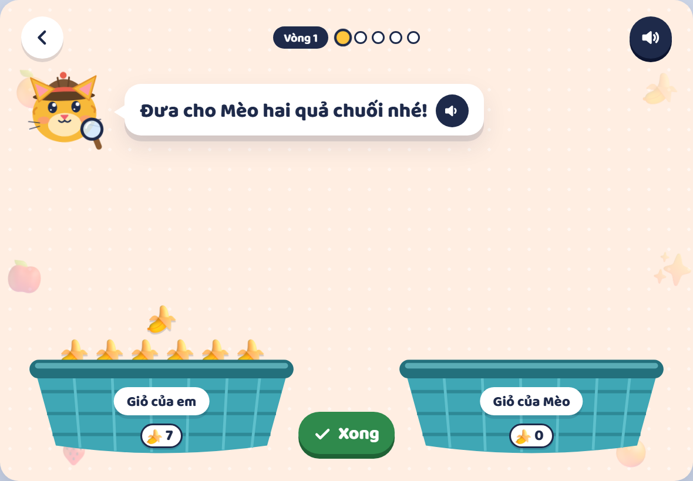 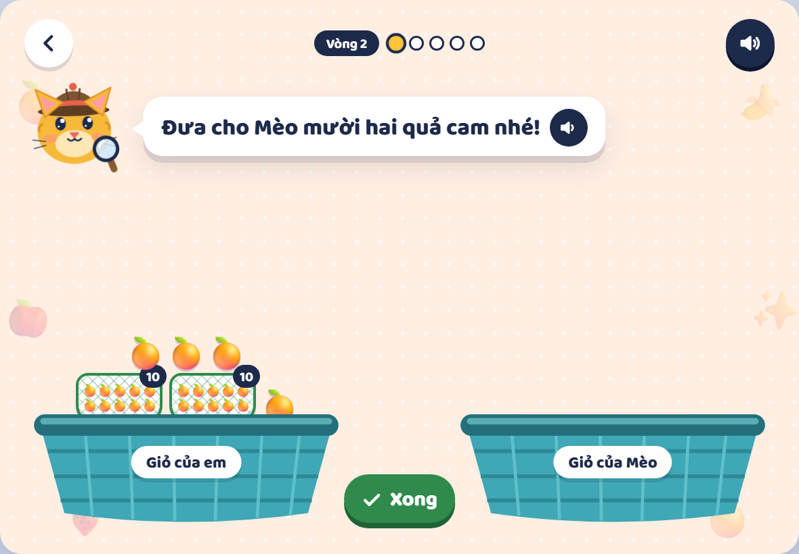

*Giỏ trái cây: Vòng 1 (trái, có số quả) và Vòng 2 (phải, có túi 10 quả).*

> 💡 Giáo viên nên xác nhận cách gọi tên bằng tiếng Việt ("quả cam", "chùm nho"...). Lời đọc có thể sửa trong kịch bản thu âm.

### Tính theo hình

**Dạy gì:** mỗi hình là một con số; thay số vào phép tính; suy luận ngược (tìm số chưa biết).

- **Vòng 1:** **Bảng số** cho biết mỗi quả là số mấy (ví dụ táo = 1); em thay số vào rồi cộng.
- **Vòng 2:** tổng ba số hạng và suy luận ngược (táo + táo = 2, vậy táo = ?).
- **Vòng 3:** một chuỗi **manh mối**; em tìm manh mối chỉ có **một** loại quả chưa biết, giải nó trước, rồi thay vào manh mối tiếp theo.
- Mỗi bước luôn chỉ có **một ẩn số**: không bao giờ phải giải hai phương trình cùng lúc, và đáp án là **duy nhất**.
- Em chạm số trên bàn phím rồi bấm "Xong".

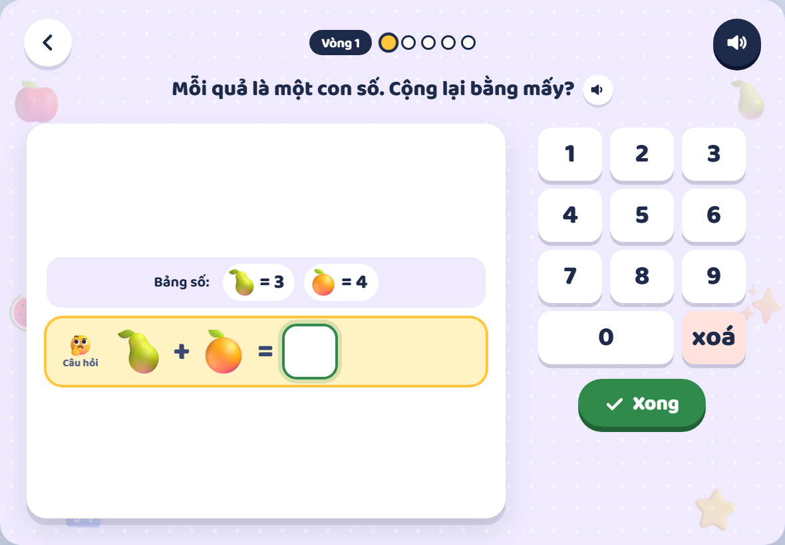 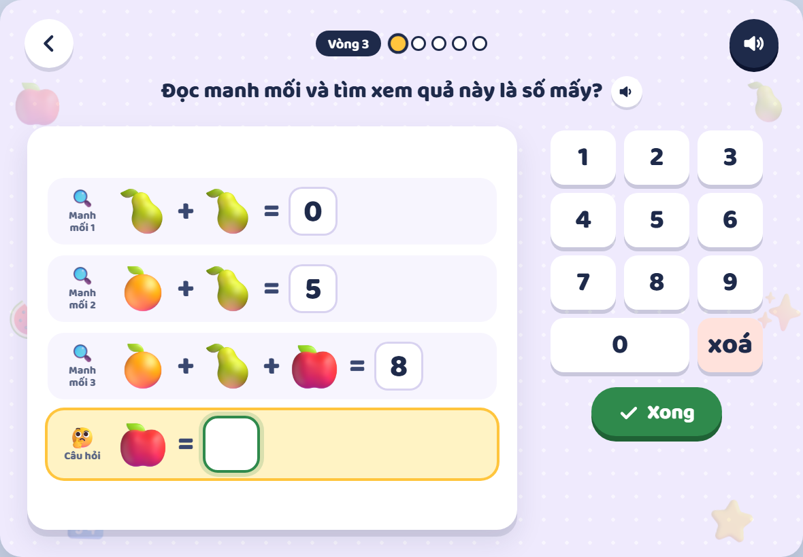

*Tính theo hình: Vòng 1 (trái) và Vòng 3 (phải).*

### Mấy và mấy

**Dạy gì:** tách và gộp số (bài "Mấy và mấy" ở lớp 1): một số gồm hai số nhỏ hơn; sơ đồ tách số; số 0.

- **Vòng 1:** một lọ hoa hoặc giỏ quả bằng hình, **một ô trống** (thường là tổng). Em chạm vào từng bông để **đánh dấu đã đếm**.
- **Vòng 2:** hình ảnh cùng **sơ đồ tách số** (số trên cùng nối với hai số dưới), **hai ô trống**; có thể có số 0.
- **Vòng 3:** chỉ còn sơ đồ tách số với **một phần còn thiếu** (ví dụ 7 = 3 + ?) và số lớn hơn.
- Câu hỏi được đọc to; mỗi ô trống có hình nhỏ của vật tương ứng. Các loại vật khác nhau về **hình dạng** chứ không chỉ về màu sắc.

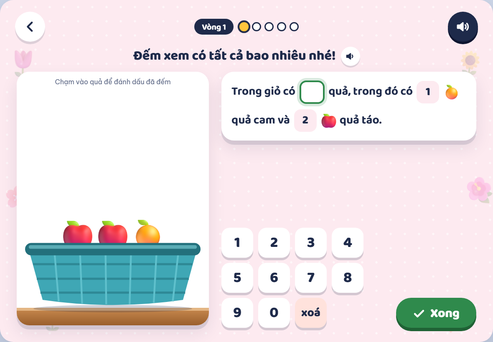 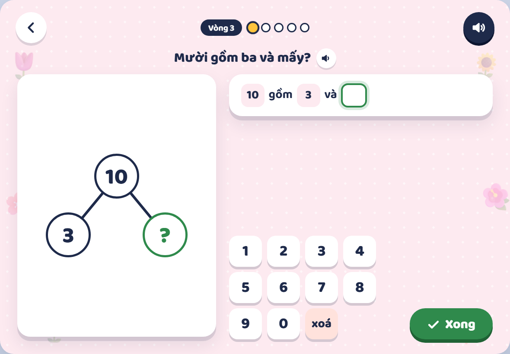

*Mấy và mấy: Vòng 1 (trái) và Vòng 3 (phải).*

### So sánh cân

**Dạy gì:** suy luận từ những lần so sánh (nếu A nhẹ hơn B và B nhẹ hơn C thì...).

- Vài cái cân nhỏ cho thấy **hộp nào nặng hơn hộp nào**. Các hộp **to bằng nhau**, nên em không đoán được từ kích thước.
- **Bên nào hạ xuống là bên nặng hơn.** Em đọc từng cân để tìm ra manh mối.
- Em **chạm vào hộp nặng nhất (hoặc nhẹ nhất)**, hoặc **xếp các hộp từ nhẹ đến nặng** rồi bấm "Xong". Không có câu hỏi có/không.
- **Vòng 1:** 3 hộp, 2 cân. **Vòng 2:** 4 hộp, 3 cân. **Vòng 3:** có một cân được vẽ theo chiều ngược lại.

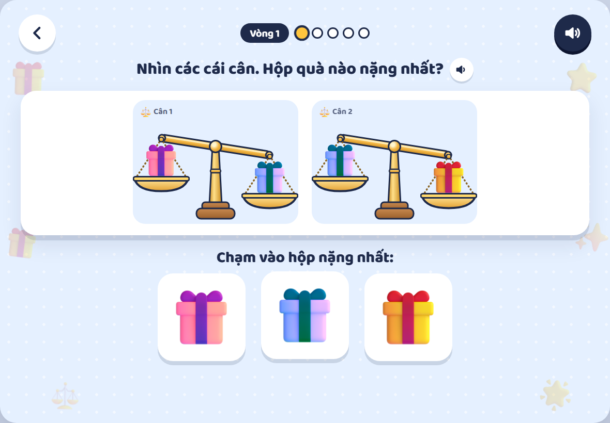 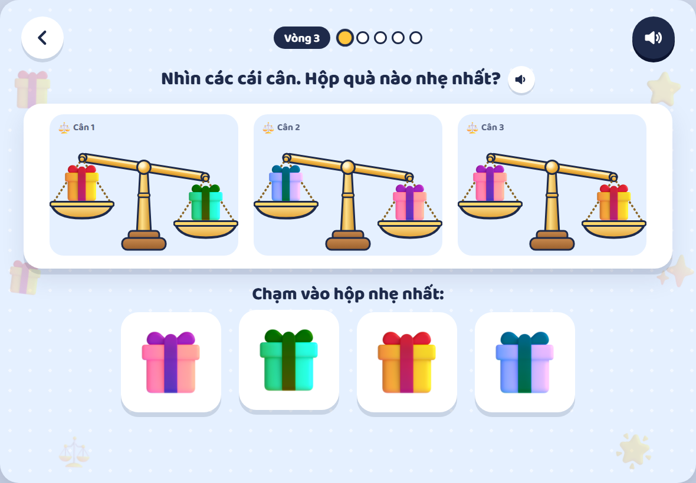

*So sánh cân: Vòng 1 (trái) và Vòng 3 (phải).*

## 7. Nút hướng dẫn (i) và "Mèo làm mẫu"

Mỗi trò chơi có nút **(i)** ở góc trên bên phải. Chạm vào đó, Mèo Smarty chỉ cách chơi bằng **bốn bước ngắn, vừa hiện chữ vừa đọc to** (bước đang đọc được tô vàng). Nút **"Nghe lại"** đọc lại từ đầu.

Hướng dẫn **tự mở ở lần đầu tiên** mỗi em chơi một trò. Sau khi đóng, Mèo đọc lại câu hỏi.

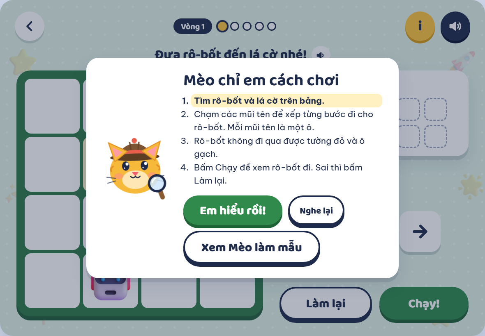
*Hướng dẫn tự mở ở lần đầu: bốn bước, "Nghe lại" và "Em hiểu rồi!".*

#### "Xem Mèo làm mẫu" (Rô-bốt và Cái cân)

Hai trò khó giải thích bằng lời nhất có thêm nút **"Xem Mèo làm mẫu"**. Một **bàn tay ma** làm mẫu một câu hoàn chỉnh trên màn hình, đúng bằng những thao tác em sẽ làm (chạm mũi tên rồi chạm "Chạy!"; chạm quả rồi chạm đĩa cân), Mèo vừa làm vừa nói. Đây chỉ là mẫu: **không tính điểm** và không đụng tới câu hỏi thật. Em có thể **"Dừng"**, **"Xem lại"** hoặc bấm **"Đến lượt em!"**.

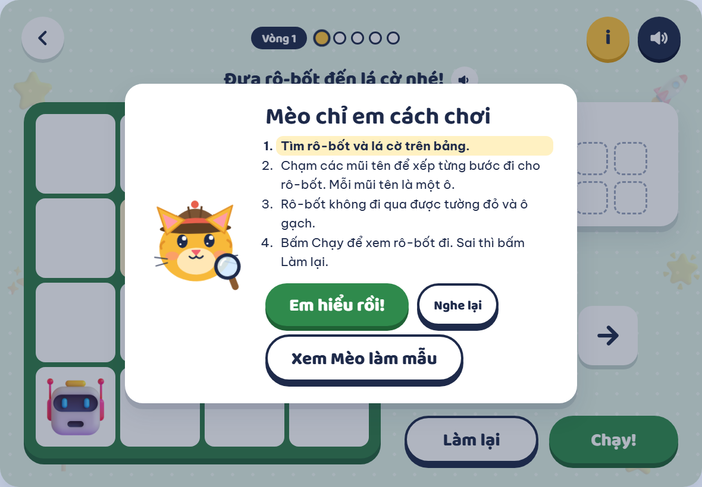
*Với Rô-bốt và Cái cân, thẻ hướng dẫn có thêm nút "Xem Mèo làm mẫu".*

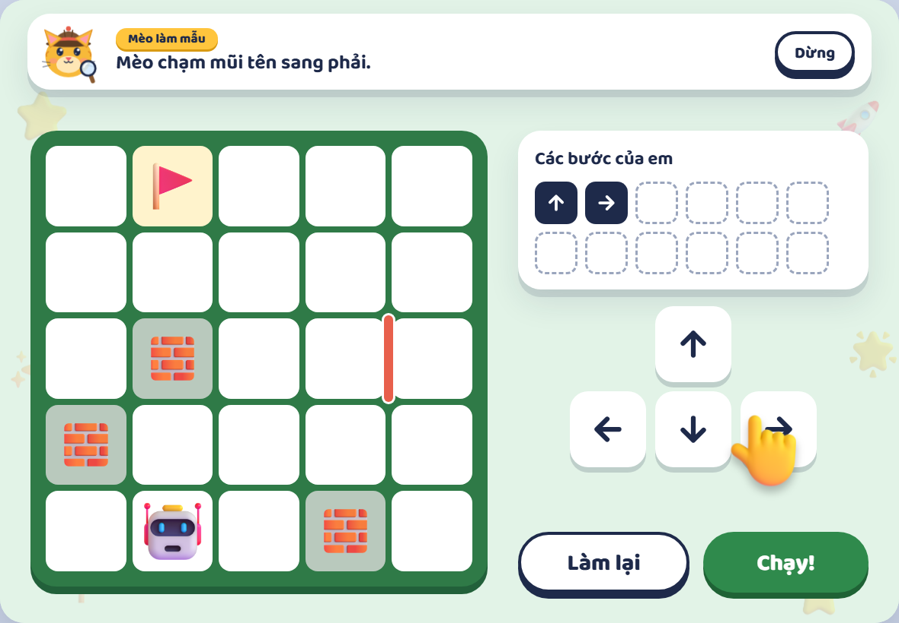 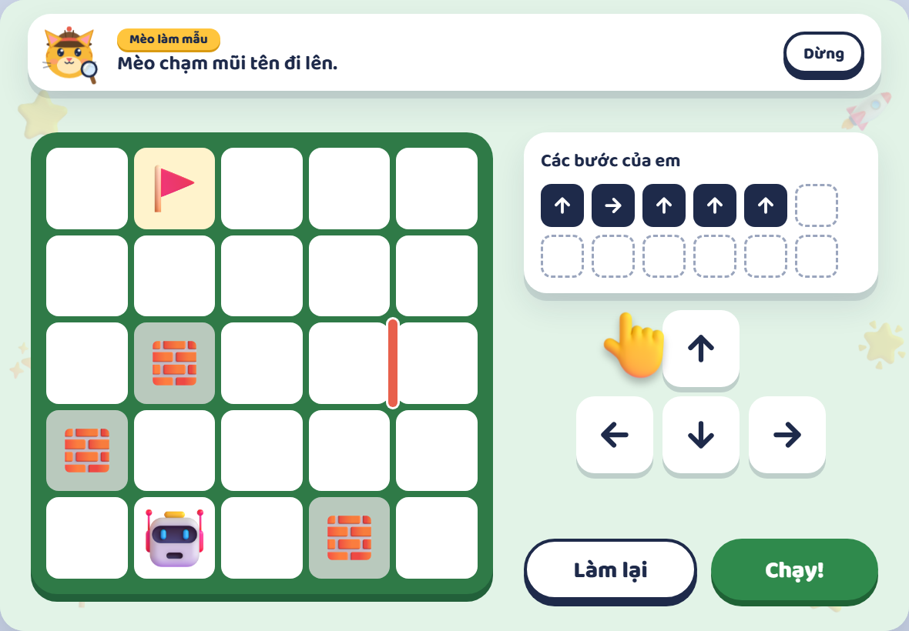 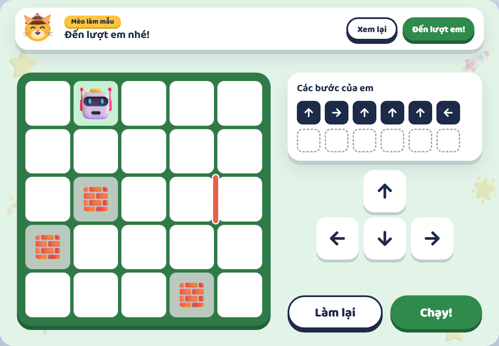

*Rô-bốt: bàn tay ma xếp từng bước, bấm "Chạy!", rô-bốt tới lá cờ.*

▶ [Xem video: Mèo làm mẫu trò Rô-bốt.](video/demo-robot.webm)

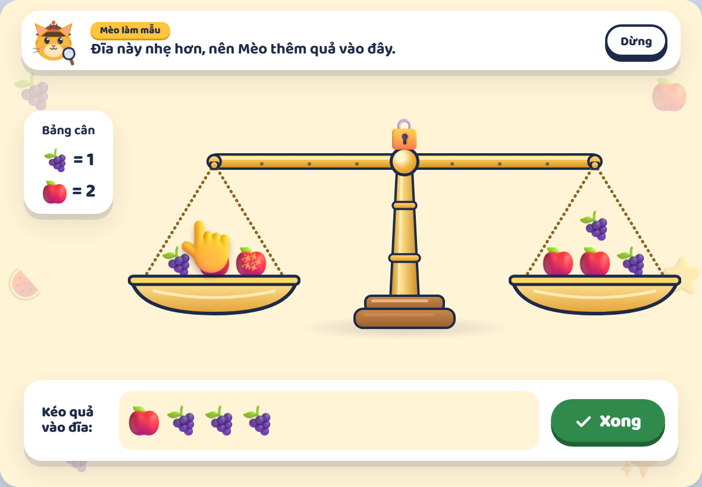 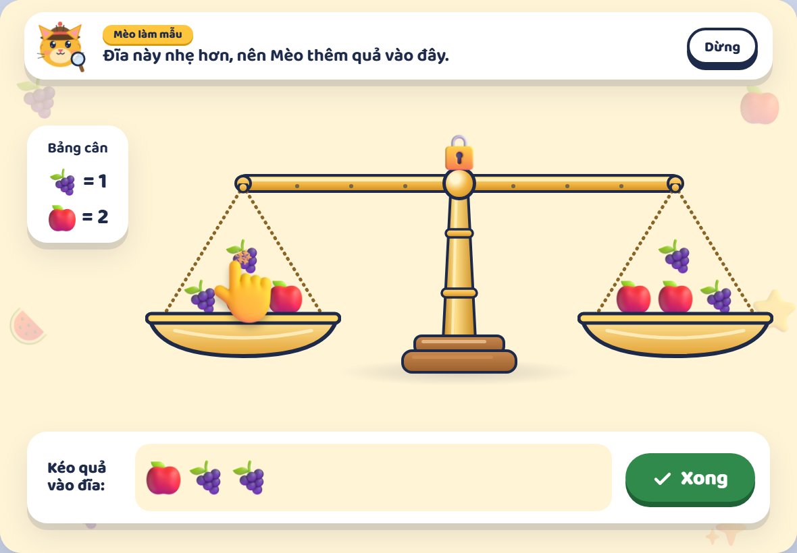 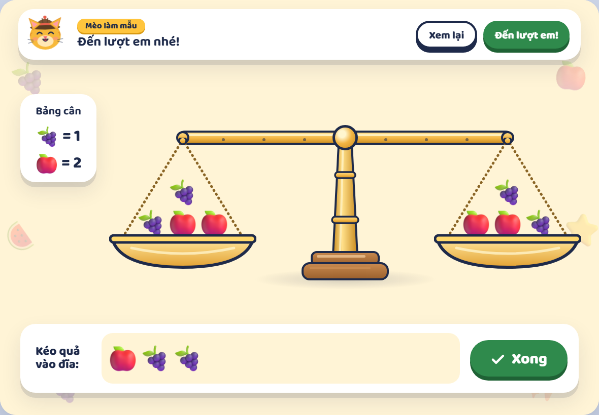

*Cái cân: nhìn bảng cân, thêm quả vào đĩa nhẹ hơn cho hai đĩa bằng nhau.*

▶ [Xem video: Mèo làm mẫu trò Cái cân.](video/demo-scale.webm)

## 8. Ba Vòng và độ khó tự điều chỉnh

| Vòng | Cảm giác |
| --- | --- |
| **Vòng 1** | Khởi động: số nhỏ (trong 10), có hình ảnh hỗ trợ, chỉ cần nghĩ một điều. |
| **Vòng 2** | Vừa sức: ít gợi ý hơn, cần nghĩ hai điều. |
| **Vòng 3** | Thử thách: số lớn hơn, ít gợi ý, nhiều bước hơn. |

Trong mỗi Vòng còn có **các bậc nhỏ ẩn** (ví dụ số đến 5, rồi đến 8, rồi đến 10). Các em không thấy các bậc này; ứng dụng dùng chúng để độ khó tăng mượt mà. Đọc **bảng "Học sinh"** trong Khu vực giáo viên để biết mỗi em đang ở Vòng nào của từng trò.

#### Trong một lượt 5 câu

- **Đúng** câu hỏi (ngay lần đầu) → tiến dần lên Vòng cao hơn.
- **Sai** → phải trả lời đúng thêm **một câu nữa** ở Vòng hiện tại mới được lên (một "hình phạt" nhẹ để khuyến khích cẩn thận).
- Vòng 2 luôn có **ít nhất 2 câu** trước khi lên Vòng 3.
- **Sai hai câu liên tiếp** → lùi xuống một Vòng.
- Trong một lượt, em chỉ lên được **nhiều nhất một Vòng** so với lúc bắt đầu lượt.

#### Điểm xuất phát của lượt sau

- Đúng **4 hoặc 5 / 5** → lượt sau bắt đầu **cao hơn một bậc nhỏ**.
- Đúng **0 hoặc 1 / 5** → lượt sau bắt đầu **thấp hơn một bậc nhỏ**.
- Còn lại → giữ nguyên.

> 💡 Lên tới **Vòng 3 là khó và cần vài ngày**: điểm xuất phát chỉ nhích một bậc nhỏ mỗi lượt. Điều này có chủ ý, để thưởng cho sự cẩn thận chứ không phải sự nhanh tay. Với giới hạn thời gian mỗi ngày, mỗi em thường chơi khoảng **một lượt cho mỗi trò mỗi ngày**.

## 9. Sao và chuỗi ngày

| Kết quả của một lượt | Sao |
| --- | --- |
| Hoàn thành lượt 5 câu (đã cố gắng) | ⭐ |
| Đúng từ 3 câu trở lên | ⭐⭐ |
| Đúng cả 5 câu | ⭐⭐⭐ |

- Sao được **cộng dồn** thành tổng, hiện ở trang chủ.
- Nhận **ít nhất 1 sao trong một ngày** là giữ được **chuỗi ngày**. Lời nhắn luôn tích cực.
- Thứ Bảy và Chủ nhật **không làm đứt chuỗi** (giáo viên có thể tắt trong Khu vực giáo viên).

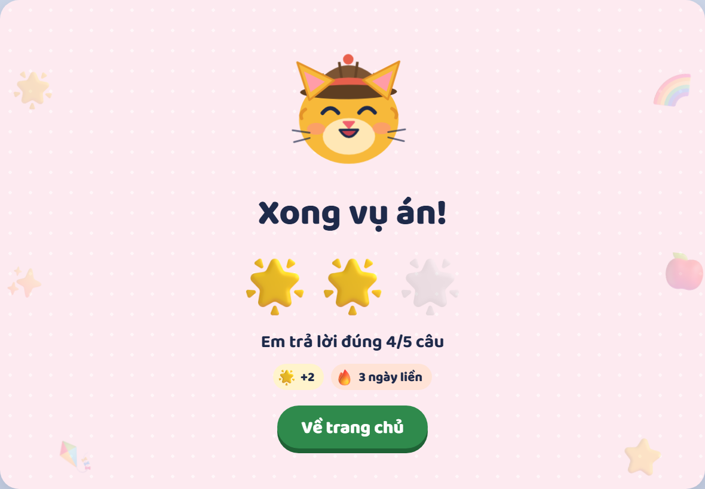
*Cuối lượt chơi: sao, điểm và chuỗi ngày.*

## 10. Thời gian chơi lành mạnh

Thời gian được tính **riêng cho từng em**. Giới hạn do người lớn cài trong Khu vực giáo viên (mặc định như bảng dưới).

| Quy tắc | Điều xảy ra |
| --- | --- |
| **Mỗi lượt** 15 phút | Màn hình **nghỉ mắt** (mặc định 5 phút) có đồng hồ đếm ngược; Mèo ngủ. Hết giờ nghỉ, tự quay về trang chủ. |
| **Mỗi ngày** 30 phút | Báo trước **2 phút**. Hết giờ, hiện màn hình **"Hôm nay mình chơi đủ rồi!"** cho đến ngày mai. |
| **Không chạm màn hình** | Sau khoảng **20 giây** Mèo hỏi "Em có cần Mèo giúp không?". Sau khoảng **60 giây** trò chơi **tạm dừng**; chạm vào để chơi tiếp. Thời gian không chạm **không bị tính**. |
| **Không ngắt giữa chừng** | Nếu hết giờ khi đang làm dở, em được làm **nốt lượt đó**; nghỉ mắt hay khoá chỉ hiện khi em về trang chủ hoặc bắt đầu lượt mới. |

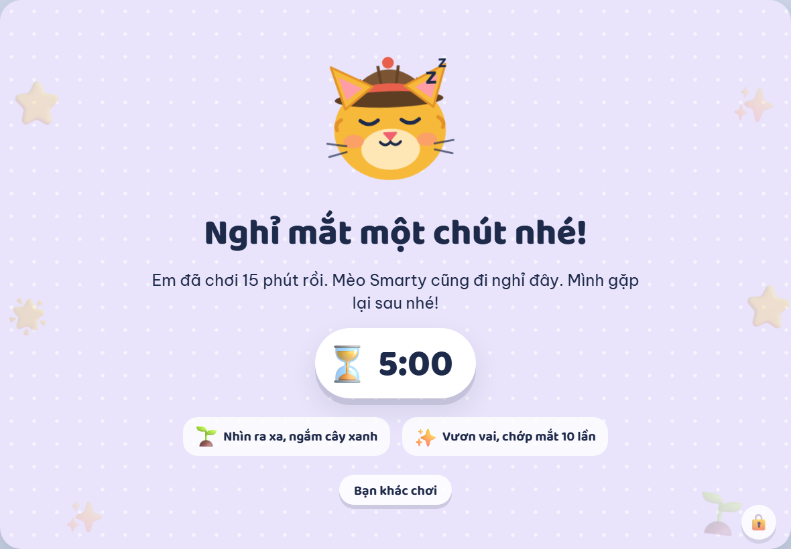 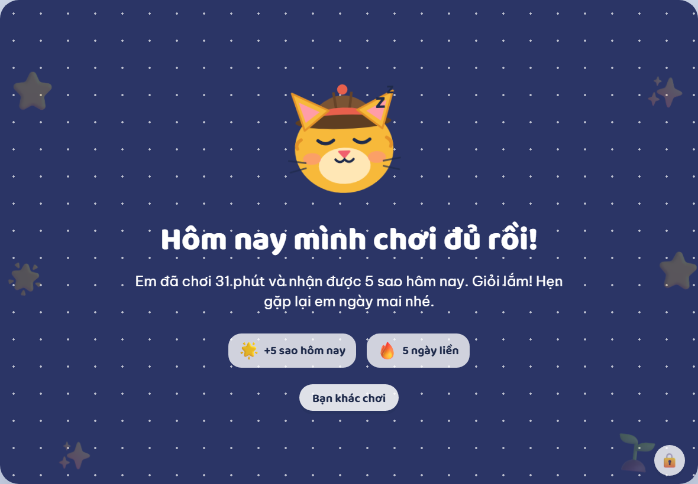

*Màn hình nghỉ mắt (trái) và "Hôm nay mình chơi đủ rồi!" (phải). Ổ khoá nhỏ vẫn ở góc dưới để người lớn mở thêm giờ.*

Trên cả hai màn hình có nút **"Bạn khác chơi"**: một em khác có thể tiếp tục trên cùng thiết bị (mỗi em có đồng hồ riêng).

## 11. Khu vực giáo viên

**Mọi cài đặt** (hiệu ứng, thời gian, bạn nào dùng máy, sao lưu, mã PIN) nằm **chỉ ở đây**, không bao giờ trên màn hình của các em. Mã PIN giúp các em không tự đổi cài đặt. **Đây không phải bảo mật thật:** người lớn rành máy tính vẫn có thể sửa dữ liệu trên trình duyệt.

#### Cách vào

1. Giữ **ổ khoá nhỏ** ở góc dưới bên phải khoảng **1 giây** (có ở trang chủ, màn hình chọn bạn, màn hình nghỉ mắt và màn hình hết giờ).
2. Nhập **mã PIN 4 số**. Mã mặc định là **1234**; hãy **đổi ngay** (xem dưới).
3. Sai 5 lần liên tiếp thì bàn phím chờ **30 giây**.
4. Rời khỏi khu vực (nút quay lại hoặc **"Khoá lại"**) là khoá ngay. Để yên hơn **30 phút** cũng tự khoá.

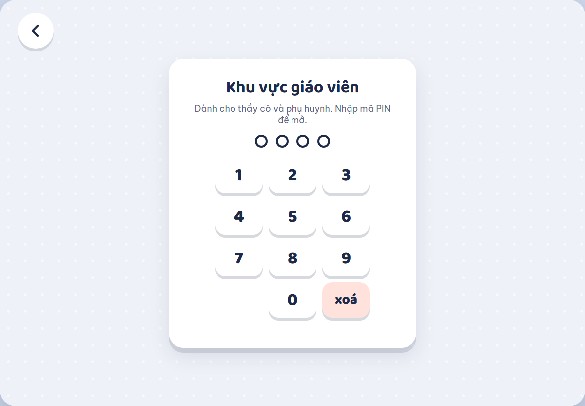
*Nhập mã PIN.*

#### Tab "Hiệu ứng"

Ba mức có sẵn: **Yên tĩnh** (tắt hết, cho các em dễ mất tập trung), **Vừa phải** (không có trang trí nền) và **Rực rỡ** (bật hết, mặc định). Hoặc bật tắt riêng: **Hoạt ảnh**, **Trang trí nền**, **Pháo hoa**, **Âm thanh hiệu ứng**. Thay đổi có hiệu lực **ngay**. Máy đặt chế độ "giảm chuyển động" sẽ tự tắt hoạt ảnh.

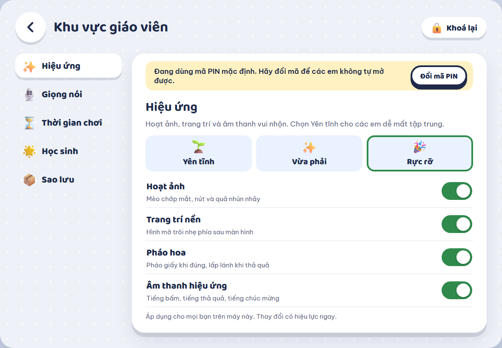
*Hiệu ứng: ba mức và bốn công tắc.*

#### Tab "Giọng nói"

Chọn **giọng đọc** của Mèo cho mọi câu hỏi, lời khen và lời nhắc. Mỗi bộ giọng là một thẻ; chạm vào thẻ để chọn (áp dụng ngay cho mọi bạn), hoặc bấm **"Nghe thử"** để nghe một câu mẫu mà **không đổi** giọng đang dùng (nghe được cả khi các em đã tắt loa).

- **Giọng của máy:** dùng giọng tiếng Việt có sẵn trong thiết bị (nếu có). Không cần tệp âm thanh; chất lượng tuỳ máy.
- **Giọng giáo viên:** các bản thu âm của giáo viên. Thẻ này mờ cho đến khi có bản thu (xem phần "Giọng nói của Mèo (thu âm)").
- **Các bộ giọng máy tạo** (nếu người cài đặt có thêm), ví dụ "Hoài My", "Nam Minh": giọng tổng hợp, dùng tạm cho đến khi có bản thu của giáo viên. Thẻ cho biết có bao nhiêu trên 132 đoạn; đoạn nào thiếu sẽ được đọc bằng giọng của máy.
- Nếu chưa chọn gì, ứng dụng tự dùng bộ giọng **đầy đủ** đầu tiên, nên giọng giáo viên sẽ tự thay thế khi đã thu xong. "Dùng bộ mặc định" quay lại cách này.

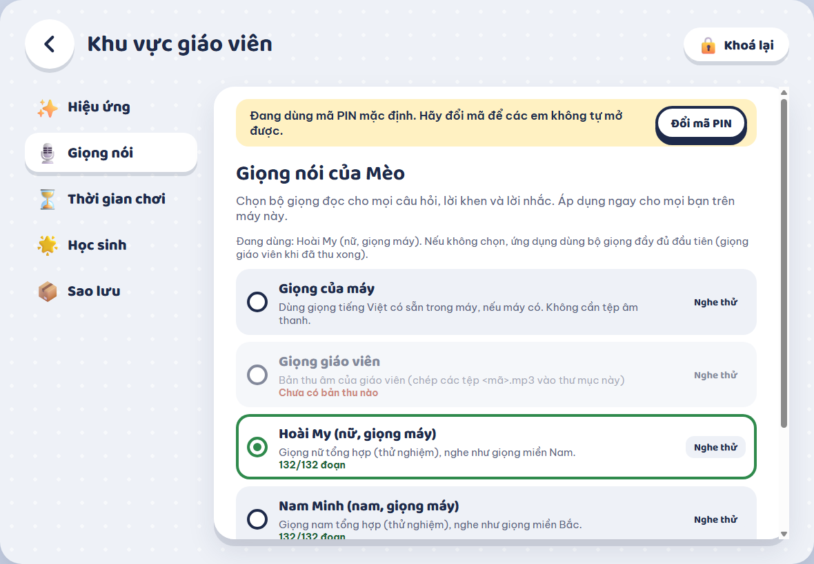
*Chọn giọng nói: mỗi bộ giọng một thẻ, "Nghe thử" để nghe mẫu.*

#### Tab "Thời gian chơi"

- **Hôm nay của (tên em đang chơi):** thời gian đã chơi, còn lại; nút **+10 phút** và **+20 phút** (mở khoá khi em đã hết giờ), và **"Kết thúc nghỉ mắt"** khi em đang nghỉ.
- Thanh trượt: **mỗi lượt chơi** (5–30 phút), **thời gian nghỉ mắt** (2–10 phút), **tối đa mỗi ngày** (10–60 phút), **Mèo nhắc khi không chạm màn hình** (10–60 giây; trò tạm dừng sau gấp 3 lần).
- Công tắc **Cuối tuần không làm đứt chuỗi ngày**.

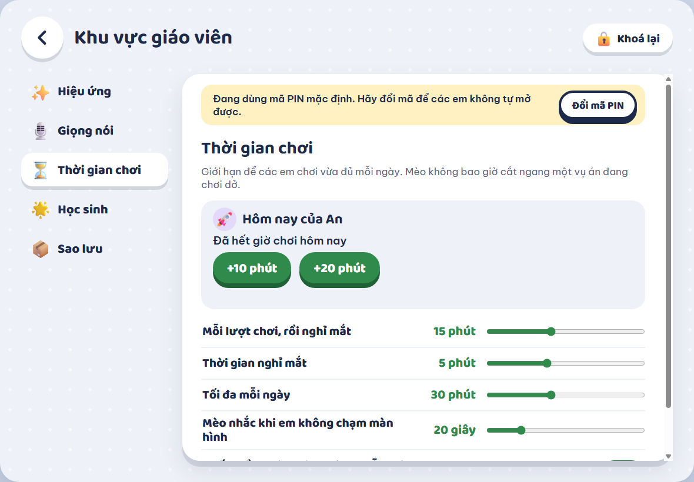
*Thời gian chơi: thêm giờ cho em đang chơi và các thanh trượt.*

> 💡 **Khi em đã hết giờ hoặc đang nghỉ:** giữ ổ khoá ngay trên màn hình đó, nhập PIN, mở tab này, bấm **+10 phút** (hoặc "Kết thúc nghỉ mắt"), rồi quay lại. Em sẽ chơi tiếp được.

#### Tab "Học sinh"

- Bảng cho thấy mỗi em: **số sao**, **chuỗi ngày** và **Vòng** (V1, V2, V3) đang ở từng trò chơi.
- **+ Thêm bạn**, **Sửa** (đổi tên và hình, tiến trình được giữ nguyên) và **Xoá** (luôn hỏi lại trước khi xoá; không khôi phục được, nên hãy sao lưu trước).

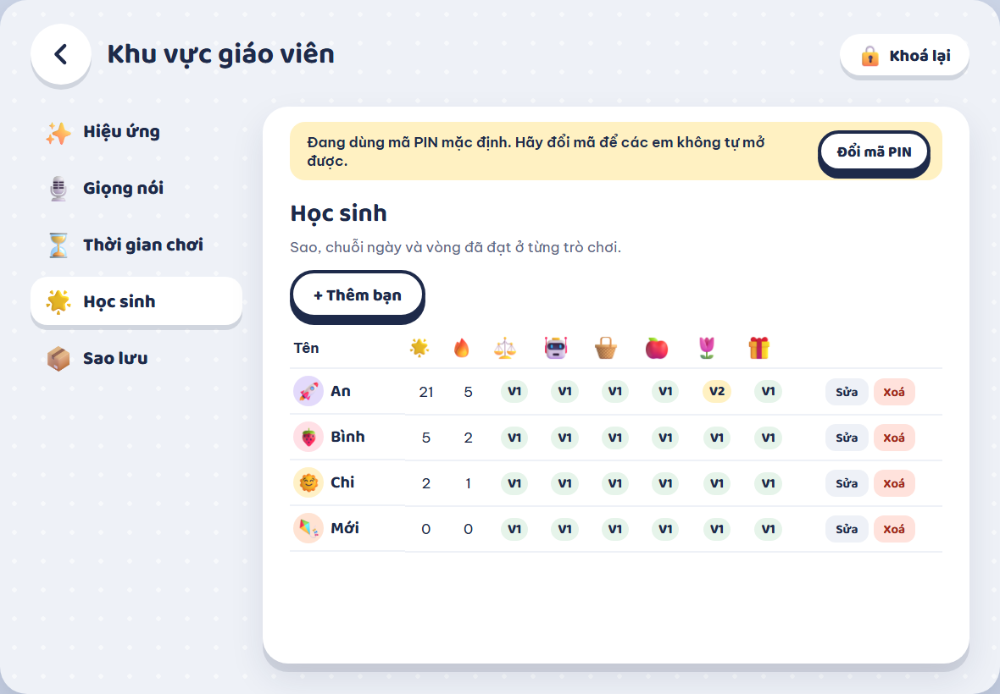
*Học sinh: sao, chuỗi ngày và Vòng của từng trò.*

#### Tab "Sao lưu" và mã PIN

- **Tải bản sao lưu:** lưu một tệp `.json` chứa **toàn bộ** hồ sơ, sao và cài đặt (kể cả mã PIN).
- **Nhập bản sao lưu:** chọn tệp đó; ứng dụng cho biết có bao nhiêu bạn rồi hỏi lại trước khi **thay thế** dữ liệu hiện có. Dùng để chuyển sang thiết bị khác hoặc khôi phục khi dữ liệu bị mất.
- **Đổi mã PIN:** nhập mã mới hai lần. Khi còn dùng mã mặc định, một thanh vàng nhắc đổi mã ở mọi tab.

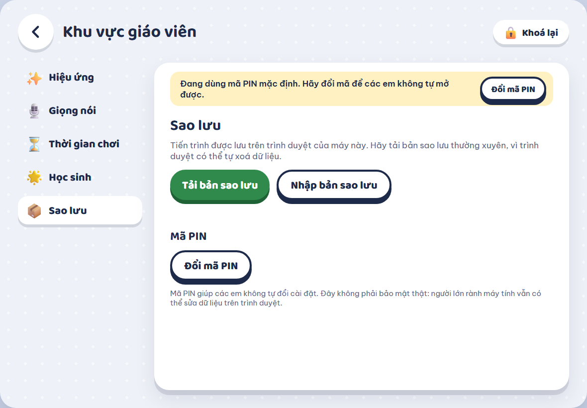
*Sao lưu và đổi mã PIN.*

> ⚠️ Dữ liệu chỉ nằm trên **thiết bị này**; không có máy chủ. Hãy **tải bản sao lưu mỗi tuần** hoặc trước khi xoá dữ liệu trình duyệt, đổi thiết bị hay xoá một bạn.

## 12. Giọng nói của Mèo (thu âm)

Giọng đọc được ghép từ các **đoạn thu ngắn dùng lại được** (số 0–20, phép tính, lời khen, lời nhắc, các bước hướng dẫn...), do **giáo viên thu âm** để giọng quen thuộc và đúng dấu thanh. Danh sách đầy đủ, với đúng lời cần đọc, ở tệp **`docs/AUDIO_SCRIPT.md`**.

1. Thu từng đoạn trong kịch bản, lưu thành `<mã>.mp3` (ví dụ `n7.mp3`) vào thư mục **`public/audio/teacher/`**.
2. Build lại ứng dụng và đưa lên (hoặc chạy lại bản Windows). Trong Khu vực giáo viên, tab **Giọng nói**, chọn **Giọng giáo viên** (hoặc để mặc định: khi đủ 132 đoạn, giọng giáo viên được dùng tự động). Đoạn nào chưa thu thì ứng dụng **đọc bằng giọng tiếng Việt của thiết bị** (nếu có), hoặc im lặng và chỉ hiện chữ.

## 13. Gặp sự cố?

| Hiện tượng | Cách xử lý |
| --- | --- |
| Không có tiếng | Kiểm tra **nút loa** trên trang chủ (có thể đang tắt), âm lượng của thiết bị và công tắc im lặng. Trên iPad, chạm vào màn hình một lần để mở khoá âm thanh. Nếu thiết bị không có giọng tiếng Việt và chưa thu âm, ứng dụng chỉ hiện chữ. |
| Màn hình "Em hãy xoay ngang máy" | Xoay máy tính bảng ngang, hoặc dùng máy tính bảng / máy tính thay cho điện thoại. |
| Em không chơi tiếp được (nghỉ mắt hoặc hết giờ) | Giữ ổ khoá trên màn hình đó, nhập PIN, tab **Thời gian chơi**: **+10 phút** hoặc **Kết thúc nghỉ mắt**. |
| Mất tiến trình của các em | Thường do trình duyệt xoá dữ liệu (đặc biệt Safari sau 7 ngày không dùng, nếu chưa thêm vào Màn hình chính). Vào Khu vực giáo viên, tab **Sao lưu**, **Nhập bản sao lưu**. Vì vậy hãy sao lưu thường xuyên. |
| Quên mã PIN | Xoá dữ liệu trang web của ứng dụng trong cài đặt trình duyệt sẽ đặt lại mã về 1234, **nhưng cũng xoá mọi tiến trình**. Hãy giữ sẵn một bản sao lưu để nhập lại. |
| Muốn dùng trên thiết bị khác | Tải bản sao lưu ở thiết bị cũ, nhập ở thiết bị mới. Hai thiết bị **không tự đồng bộ**. |
| Sau khi cập nhật vẫn thấy bản cũ | Mở ứng dụng khi có mạng rồi đóng hẳn và mở lại một lần; bản mới sẽ thay bản cũ. |

---

*Hướng dẫn này được tạo tự động từ ứng dụng thật (ảnh chụp màn hình và video). Nếu màn hình khác ảnh, hãy báo cho người cài đặt để cập nhật.* Phiên bản ứng dụng: 0.1.0.
