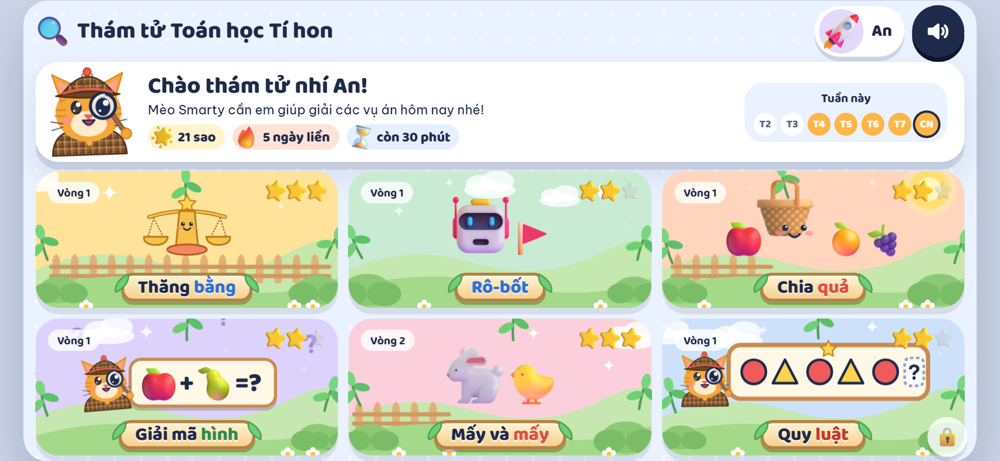
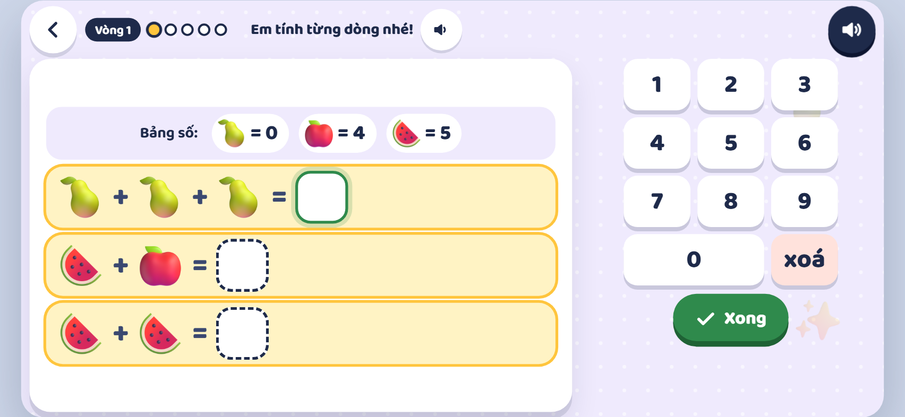
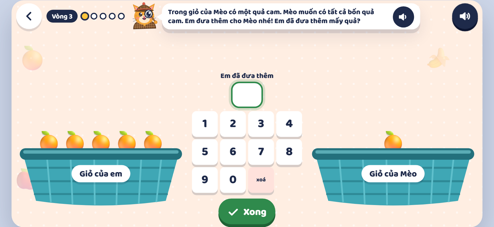
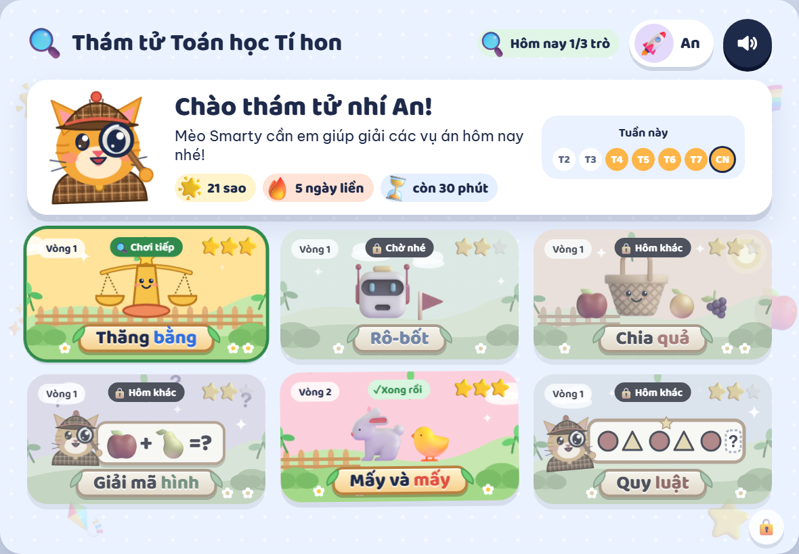
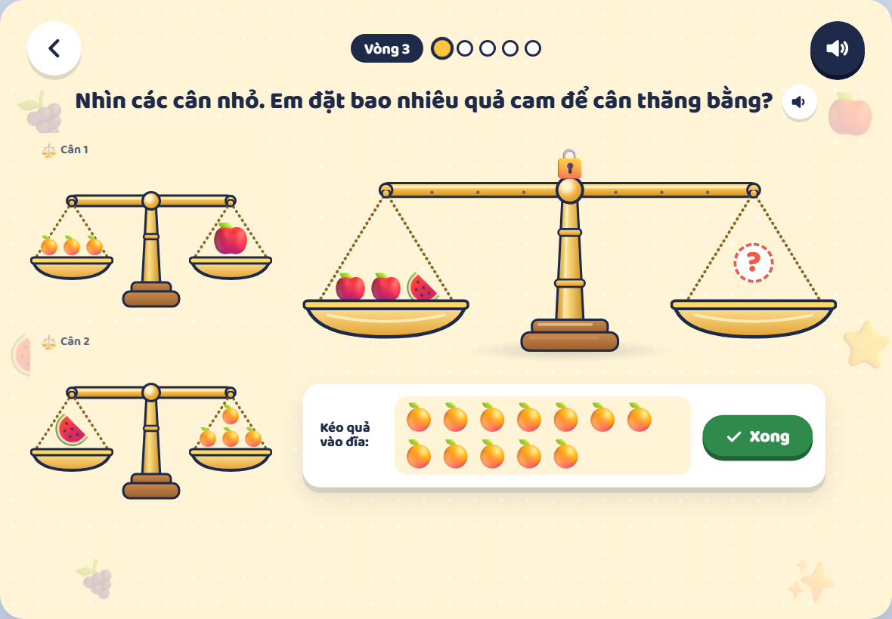
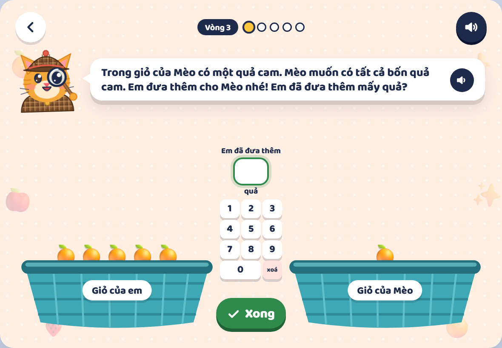
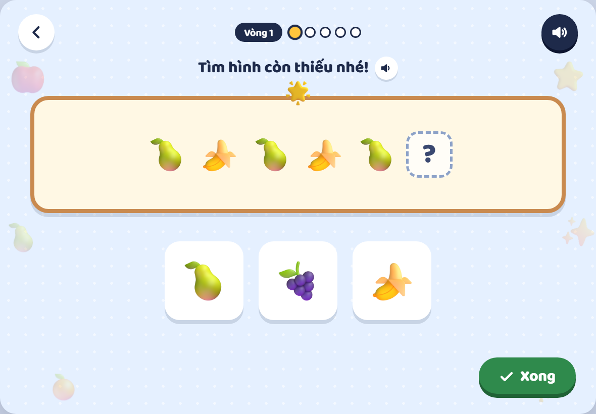
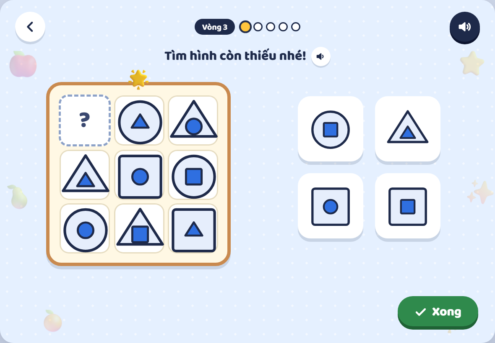
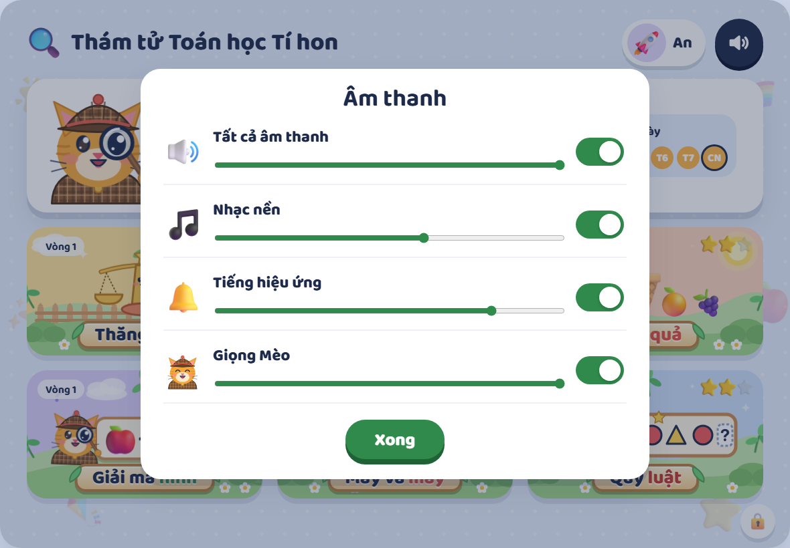
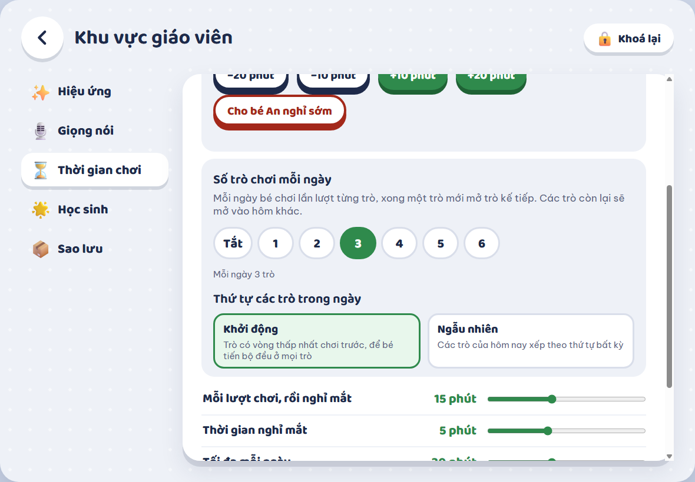

# Little Math Detectives: User Guide

*For teachers and parents of grade 1 children*

[Tiếng Việt](HUONG_DAN.md)

## Contents

- [1. What is this app?](#1-what-is-this-app)
- [2. Getting started](#2-getting-started)
- [3. Using a phone](#3-using-a-phone)
- [4. One profile per child](#4-one-profile-per-child)
- [5. The home screen](#5-the-home-screen)
- [6. A case (one round of play)](#6-a-case-one-round-of-play)
- [7. The six games](#7-the-six-games)
   - [Thăng bằng (the balance scale)](#thăng-bằng-the-balance-scale)
   - [Rô-bốt (the robot)](#rô-bốt-the-robot)
   - [Chia quả (sharing fruit)](#chia-quả-sharing-fruit)
   - [Giải mã hình (picture sums)](#giải-mã-hình-picture-sums)
   - [Mấy và mấy (splitting numbers)](#mấy-và-mấy-splitting-numbers)
   - [Quy luật (patterns)](#quy-luật-patterns)
- [8. The (i) guide and "Mèo's worked example"](#8-the-i-guide-and-mèos-worked-example)
- [9. The three Vòng and adaptive difficulty](#9-the-three-vòng-and-adaptive-difficulty)
- [10. Stars and the daily streak](#10-stars-and-the-daily-streak)
- [11. Sound and music](#11-sound-and-music)
- [12. Healthy screen time](#12-healthy-screen-time)
- [13. The Teacher area](#13-the-teacher-area)
- [14. Mèo's voice (recording)](#14-mèos-voice-recording)
- [15. Troubleshooting](#15-troubleshooting)

## 1. What is this app?

**Little Math Detectives** is a set of six small math games for grade 1 children (age 6). The children help a detective cat, **Mèo Smarty**, solve "cases": each case is a set of 5 short math questions.

- Six games: **Thăng bằng** (the balance scale), **Rô-bốt** (the robot), **Chia quả** (sharing fruit), **Giải mã hình** (picture sums), **Mấy và mấy** (splitting numbers) and **Quy luật** (patterns). Together they practise counting, number sense, adding and subtracting within 10 (later 20) and first logical reasoning.
- Aligned with the **2018** curriculum (Kết nối tri thức), starting from the numbers 0–10.
- Everything a child reads or hears is in **Vietnamese**. Mèo Smarty **reads it aloud**, because the children are still learning to read.
- **No network** needed after the first visit, **no accounts**. Progress is saved on the device.
- Difficulty **adapts** to each child (three "Vòng" or rounds), with reward stars, a daily streak, time limits and an adults-only area.

*The home screen: six games, stars, streak and time left.*

## 2. Getting started

The app runs on a **tablet held sideways** (iPad) or a **computer**. In portrait mode or on a phone, the screen asks to turn the device sideways.

#### Option 1: in a browser

Open the web address your school gives you. The first visit needs a network; after that the app also opens without one.

#### Option 2: add to the iPad Home Screen (recommended)

1. Open the page in **Safari**.
2. Tap **Share** (the square with an arrow pointing up).
3. Choose **"Add to Home Screen"**.
4. Open the app from the Mèo Smarty icon on the Home Screen, once while online.

> 💡 Adding it to the Home Screen also helps **keep the data**: Safari may delete data of a website not used for 7 days, but not of an installed app. Still, make **backups** regularly (see the Teacher area section).

#### Option 3: Windows app

There is a Windows version (an `.exe` file) that runs in its own window like any program, with no browser or network needed. Ask whoever sets it up to run `npm run desktop:build`, or use the ready-made file.

## 3. Using a phone

The app works best on a **tablet** held sideways. At the teachers' request a **phone** (iPhone 15 and up) works too, **when held sideways**: the screen switches to a wide, short layout whose buttons and number keys are still big enough for small fingers.

- Hold the phone **sideways**. Held upright, Mèo says "Em hãy xoay ngang máy nhé!" (please turn the device sideways).
- Do **add it to the Home Screen** (Share → Add to Home Screen) for full screen and so Safari does not clear the data.
- A phone screen is small: for young children a **tablet is still the better choice**.

*The home screen on a phone held sideways (iPhone 15).*

 

*Two games on a phone: buttons and number keys stay big.*

## 4. One profile per child

Several children can share one device. When the app opens, each child taps their own **picture**: no password. Stars, streak, difficulty and play time are saved **separately for each child**.

*The "Who is playing today?" screen.*

On the very first run the **"Add a friend"** form opens by itself: type a name and pick a picture. Teachers can also add, rename or remove children in the **Teacher area**.

*Adding a friend: a name and a picture.*

## 5. The home screen

- Mèo Smarty greets the child by name.
- The child's **total stars**, **streak** of consecutive days and **time left** today.
- **This week**: the days with stars, today, and the days to come.
- **Six picture tiles**: tap one to start a case. Each tile shows the child's current **Vòng**; a "Mới!" label marks a game not played yet, and played games show the **best stars** earned. The tiles are little scenes: leaves sway, clouds drift and stars twinkle (when the teacher has the effects on).
- **A few games a day, one after another** (the teacher sets how many, 3 by default): only the tile marked **"Chơi tiếp"** is open; a "Chờ nhé" tile waits until the child finishes the game before it (Mèo says "Bé hoàn thành trò trước đã nhé!"); a "Hôm khác" tile opens another day. A game finished today (✓) can be **replayed for fun**, but earns nothing. The "Hôm nay 1/3 trò" label at the top shows how many are done.
- **Speaker button**: **tap** to switch all sound on or off; **hold** it for about half a second to open the sound mixer (see "Sound and music"). It is the **only setting** a child can change.
- The small **padlock** in the bottom-right corner is for adults: **hold it for about 1 second** to enter the Teacher area (a PIN is asked).

*The daily plan: "Chơi tiếp" (open now), "Chờ nhé" (waits for the game before), "Hôm khác" (not part of today), ✓ (done, can be replayed for fun).*

*The padlock (circled in red) in the bottom-right corner: hold it for about 1 second. A quick tap only shows a hint.*

## 6. A case (one round of play)

- A round is a **set of 5 questions** in one game. Five dots at the top show how far the child has got, next to the current **Vòng** (round).
- Each question is **read aloud** by Mèo Smarty; the words are also on screen. The small speaker next to the question **plays it again**.
- Everything you can drag also works by **tapping**: tap the object, then tap where it should go.
- When finished, the child taps the green **"Xong"** (done) button (or "Chạy!" (run) in the Robot game).
- The round arrow at the top left goes back home. Leaving half way **does not save** that round.

#### When the answer is wrong

1. Mèo Smarty says gently "Almost!" and gives a **hint**: no red cross or scary sound.
2. The child gets **one more try**.
3. If it is still wrong, Mèo **shows the answer** and moves on.
4. Only the **first try** counts for the score; the second try is for learning.

 

*Right: praise and confetti. Wrong: a gentle hint and another try.*

## 7. The six games

Each game has three **Vòng** (rounds 1, 2, 3). Below: what each game teaches, how it is played and how the rounds differ. The left picture is Vòng 1; the right one a higher Vòng.

### Thăng bằng (the balance scale)

**What it teaches:** "equal" means *equal total weight*; comparing and ordering by weight; reasoning from weighings (if A weighs 2 B and B weighs 2 oranges, how many oranges is A?).

- **Vòng 1, balance it:** two pans, each already holding some fruit. The child **drags fruit from the tray into a pan** (or taps a fruit, then a pan) so that **both pans weigh the same**, then taps "Xong". Weights (shown in the "Bảng cân" key): grapes = 1, apple = 2, watermelon = 3.
- First steps: one kind of fruit, the scale **tips at once**, each pan shows its count and a **>, <, =** sign. Later steps: two, then three kinds of fruit; a **padlock holds the scale level** until the child taps "Xong".
- **Vòng 2, compare scales:** a few small scales show **which box is heavier than which** (the boxes are **the same size**, so size gives nothing away; **the side that goes down is heavier**). The child taps the **heaviest / lightest** box, then **puts the boxes in order from light to heavy**.
- **Vòng 3, inference:** two small **balanced** scales tell, for example, *1 mango weighs 3 oranges*, *1 apple weighs 2 oranges*. The big scale has fruit on the left and an **empty right pan marked ?**: the child **puts oranges on the empty pan** to balance it. The last steps need **two chains of reasoning** (1 watermelon = 2 apples, 1 apple = 2 oranges). The weights are never written as numbers: the child reads them off the small scales.
- Every question has **one right answer**; only Vòng 1 has many right arrangements.

  

*Thăng bằng: Vòng 1 (balance it), Vòng 2 (compare scales) and Vòng 3 (inference).*

### Rô-bốt (the robot)

**What it teaches:** putting steps in order (first programming), directions, counting squares and avoiding obstacles.

- The child taps the **arrows** (up, down, left, right) to build the robot's **steps**; each arrow is **one square**. At most 12 steps.
- Tap the **last step** to take it back (undo one), or **"Làm lại"** (start over) to rebuild from scratch.
- Press **"Chạy!"** (run) to watch the robot walk the steps. Reaching the flag is right. Bumping a wall or brick makes the robot shake and return to the start so the child can fix the steps.
- **Vòng 1:** an empty 4 × 4 board, short paths. **Vòng 2:** **red walls** between squares and **bricks** that cannot be entered. **Vòng 3:** a bigger board, longer paths, more obstacles.
- The levels are generated by the app and always have at least one path.

 

*Rô-bốt: Vòng 1 (left) and Vòng 3 (right).*

### Chia quả (sharing fruit)

**What it teaches:** exact counting, matching a number to a quantity, and **tens**: a bag of 10.

- Mèo Smarty says, for example, **"Give me 7 oranges"**. The child moves fruit from **"Giỏ của em"** (my basket) to **"Giỏ của Mèo"** (Mèo's basket) by dragging, or by tapping a fruit and then a basket. The count must be **exact**: too many is also wrong, and fruit can be moved back.
- **Vòng 1:** a few fruit of one kind; each basket **shows its count** to compare.
- **Vòng 2:** more fruit and the **counts are hidden**, so the child must count. There are **bags of 10** (one "chục"). The questions deliberately teach tens: "one / two chục of oranges", "ten oranges" (also 1 bag) and "thirteen oranges" (1 bag and 3).
- **Vòng 3:** three kinds of question. (1) **Several kinds** of fruit in one question, or "no bananas". (2) **Need more:** "Mèo's basket has 5 oranges. Mèo wants 15 in all. How many more did you give?"; the child moves the fruit and **types how many they added** on the small pad between the baskets. (3) **Make equal:** the two baskets hold different amounts; the child moves fruit until **both baskets are the same** (fruit sits in rows of five to make comparing easy). The fruit Mèo already has cannot be taken out.
- The child's basket always holds 2 to 9 loose fruit of a kind, so to make a ten the child must take a **bag**.
- With sound off, a **text-and-picture panel** shows the request; with sound on it appears after the first wrong try. A **"Nghe lại"** (hear again) button is always there.

  

*Chia quả: Vòng 1 (with counts), Vòng 2 (with bags of 10) and Vòng 3 (need more, with the small pad).*

> 💡 Teachers should confirm the Vietnamese counting words ("quả cam", "chùm nho"...). The spoken lines can be changed in the recording script.

### Giải mã hình (picture sums)

**What it teaches:** each picture stands for a number; substituting into a sum; reasoning backwards to find an unknown.

- **Vòng 1:** the **"Bảng số"** (number key) shows what each fruit is (for example apple = 1); the child fills in several rows, one answer box each. Every fruit has its own number.
- **Vòng 2:** sums with three terms and reverse reasoning (apple + apple = 2, so apple = ?).
- **Vòng 3:** a chain of **clues**; the child finds the clue with only **one** unknown fruit, solves it first, then substitutes into the next clue.
- Every step has exactly **one unknown**: the child never has to solve two equations together, and the answer is **unique**.
- The child taps a number on the keypad, then presses "Xong".

 

*Giải mã hình: Vòng 1 (left) and Vòng 3 (right).*

### Mấy và mấy (splitting numbers)

**What it teaches:** splitting and joining numbers (the grade 1 lesson "Mấy và mấy"): a number is made of two smaller ones; the number bond; zero.

- **Vòng 1:** a picture (a garden with **a rabbit and a chick**, a vase of flowers or a basket) with **one blank** (usually the total). The child taps each animal or flower to **mark it as counted**.
- **Vòng 2:** pictures with the **number bond** (the top number linked to two below), **two blanks**; zero can appear.
- **Vòng 3:** the number bond only, with **a missing part** (for example 7 = 3 + ?) and bigger numbers.
- Questions are read aloud; each blank has a small picture of its item. Item kinds differ by **shape**, not only by colour.

 

*Mấy và mấy: Vòng 1 (left) and Vòng 3 (right).*

### Quy luật (patterns)

**What it teaches:** spotting a pattern; looking carefully and predicting what comes next. Every question has **exactly one right answer** (the app checks each question before showing it).

- A row of pictures (or a 3×3 grid) has **one blank**. The child taps the picture that **keeps the pattern going** (or drags it onto the blank) and presses "Xong"; they can change their mind.
- **Vòng 1:** repeating rows (🍎🍐🍎🍐🍎?, then three pictures repeating, then coloured shapes), the blank at the **end** of the row.
- **Vòng 2:** the blank in the **middle**; **number** rows (add 1, add 2, add 10, take away 1); a four-picture repeat (two of one, then two of another).
- **Vòng 3:** a **blue dot moving round the corners** of a frame; a **3×3** grid of shapes inside shapes (each row and column has all three outer and all three inner shapes, none repeated).

 

*Quy luật: Vòng 1 (left) and Vòng 3 (right).*

## 8. The (i) guide and "Mèo's worked example"

Each game has an **(i)** button at the top right. Tapping it, Mèo Smarty explains how to play in **four short steps, shown in writing and read aloud** (the step being read is highlighted in yellow). **"Nghe lại"** (hear again) reads them again from the start.

The guide **opens by itself the first time** each child plays a game. When it closes, Mèo reads the question again.

*The guide opening by itself the first time: four steps, "Nghe lại" and "Em hiểu rồi!" (I get it!).*

#### "Xem Mèo làm mẫu" (watch Mèo do it): Rô-bốt and Thăng bằng

The two games that are hardest to explain in words also have a **"Xem Mèo làm mẫu"** button. A **ghost hand** works through one complete question on screen, using exactly the actions the child will use (tap the arrows then "Chạy!"; tap a fruit then a pan) while Mèo explains. It is only an example: it is **not scored** and does not touch the real question. The child can **"Dừng"** (stop), **"Xem lại"** (watch again) or press **"Đến lượt em!"** (your turn!).

*For Rô-bốt and Thăng bằng the guide card has an extra "Xem Mèo làm mẫu" button.*

  

*Rô-bốt: the ghost hand builds the steps, presses "Chạy!" and the robot reaches the flag.*

▶ [Watch the video: Mèo's worked example of Rô-bốt.](video/demo-robot.webm)

  

*Thăng bằng: read the key, add fruit to the lighter pan until both pans are equal.*

▶ [Watch the video: Mèo's worked example of Thăng bằng.](video/demo-scale.webm)

## 9. The three Vòng and adaptive difficulty

| Vòng | Feel |
| --- | --- |
| **Vòng 1** | Warm-up: small numbers (within 10), supporting pictures, one thing to think about. |
| **Vòng 2** | Just right: fewer hints, two things to think about. |
| **Vòng 3** | Challenge: bigger numbers, fewer hints, more steps. |

Inside each Vòng are **hidden small steps** (for example numbers up to 5, then 8, then 10). The children do not see them; the app uses them to raise difficulty smoothly. The **"Học sinh"** table in the Teacher area shows which Vòng each child is at in every game.

#### Inside a set of 5 questions

- A **right** first try → the child works up towards the next Vòng.
- A **wrong** first try → one **extra right answer** is needed at the current Vòng before moving up (a small "penalty" that rewards care).
- Vòng 2 always has **at least 2 questions** before Vòng 3.
- **Two wrong in a row** → down one Vòng.
- In one set a child can rise **at most one Vòng** above where the set started.

#### Where the next set starts

- **4 or 5 out of 5** → the next set starts **one small step higher**.
- **0 or 1 out of 5** → the next set starts **one small step lower**.
- Otherwise → unchanged.

> 💡 Reaching **Vòng 3 is hard and takes several days**: the starting point moves only one small step per set. This is deliberate, to reward carefulness, not speed. With the daily time limit, a child usually plays about **one set per game per day**.

## 10. Stars and the daily streak

| Result of a set | Stars |
| --- | --- |
| Finishing the set of 5 (making an effort) | ⭐ |
| 3 or more right | ⭐⭐ |
| All 5 right | ⭐⭐⭐ |

- Stars **add up** to a running total shown on the home screen.
- Earning **at least 1 star in a day** keeps the **daily streak**. The messages are always positive.
- Saturdays and Sundays **do not break the streak** (teachers can turn this off in the Teacher area).

*At the end of a set: stars, score and streak.*

## 11. Sound and music

Mèo Smarty **reads everything aloud**, and there is **light background music**: a cheerful tune for the home screen and **a different one for each game** (7 in all). The music gets quieter while Mèo speaks, and is silent in the Teacher area, on the eye-break screen and on the done-for-today screen.

- **Tap** the speaker button: all sound off or on.
- **Hold** the speaker button for about half a second (a ring of light fills around it): the **sound mixer** opens with four rows, each with a switch and a volume slider: **Tất cả âm thanh** (all sound), **Nhạc nền** (music), **Tiếng hiệu ứng** (sound effects) and **Giọng Mèo** (Mèo's voice).
- A switch remembers the volume: turning the music off and on again keeps its level.
- If a teacher switched **Nhạc nền** or **Âm thanh hiệu ứng** off in the Teacher area (for example the **Yên tĩnh** preset), that row is greyed out and says "Thầy cô đã tắt" (a teacher turned it off); the children cannot turn it back on.

*The sound mixer: hold the speaker button to open it.*

## 12. Healthy screen time

Time is counted **separately for each child**. Adults set the limits in the Teacher area (defaults below).

| Rule | What happens |
| --- | --- |
| **Each round** 15 minutes | An **eye break** screen (default 5 minutes) with a countdown; Mèo sleeps. When the break ends the app goes home by itself. |
| **Each day** 30 minutes | A warning **2 minutes** before. At the limit a **"Hôm nay mình chơi đủ rồi!"** (we have played enough today) screen stays until tomorrow. |
| **No touching** | After about **1 minute** Mèo asks "Do you need Mèo's help?". After about **3 minutes** the game **pauses** and the music fades out; a touch resumes. Idle time is **not counted**. |
| **Never mid-set** | If the time runs out half way, the child may **finish that set**; the break or lock only appears when the child goes home or starts a new set. |

 

*The eye-break screen (left) and "Hôm nay mình chơi đủ rồi!" (right). The small padlock stays in the corner so an adult can add time.*

Both screens have a **"Bạn khác chơi"** (another friend plays) button: another child can carry on on the same device (each child has their own clock).

## 13. The Teacher area

**Every setting** (effects, time, which children use the device, backups, the PIN) lives **only here**, never on a child's screen. The PIN keeps children out. **It is not real security:** a computer-savvy adult can still edit the data in the browser.

#### How to get in

1. Hold the small **padlock** in the bottom-right corner for about **1 second** (on the home screen, the child picker, the eye-break screen and the done-for-today screen).
2. Enter the **4-digit PIN**. The default is **1234**; **change it right away** (see below).
3. 5 wrong codes in a row make the keypad wait **30 seconds**.
4. Leaving the area (the back button or **"Khoá lại"** (lock again)) locks it at once. Left alone for more than **30 minutes** it locks by itself.

*Entering the PIN.*

#### The "Hiệu ứng" (effects) tab

Three presets: **Yên tĩnh** (quiet: everything off, for easily distracted children), **Vừa phải** (moderate: no background decoration) and **Rực rỡ** (bright: everything on, the default). Or switch separately: **Animation**, **Background decoration**, **Confetti**, **Sound effects**, **Background music**. Changes apply **immediately**. A device set to "reduce motion" turns animation off by itself.

*Effects: three presets and five switches.*

#### The "Giọng nói" (voice) tab

Choose Mèo's **speaking voice** for every question, praise and reminder. Each voice is a card; tap a card to choose it (it applies to every child at once), or press **"Nghe thử"** (listen) to hear a sample sentence **without changing** the voice in use (it plays even if the children have switched the speaker off).

- **Giọng của máy** (the device's own voice): uses the device's Vietnamese voice, if it has one. No audio files; quality depends on the device.
- **Giọng giáo viên** (the teacher's voice): the teacher's recordings. This card stays greyed out until there are recordings (see "Mèo's voice (recording)").
- **Machine-made voices** (if whoever installs the app added them), for example "Nam Minh" (a Northern voice, **the default**) and "Hoài My": synthetic voices used until the teacher's recordings exist. The card shows how many of the 161 clips it has; any clip it lacks is read by the device voice.
- If nothing has been chosen, the app uses the first **complete** voice, so the teacher's voice takes over by itself once everything is recorded. "Dùng bộ mặc định" returns to this.

*Choosing the voice: one card per voice, "Nghe thử" for a sample.*

#### The "Thời gian chơi" (play time) tab

- **Today of (the child who is playing):** time played and time left; the **+10 minutes** and **+20 minutes** buttons (they end a lock when a child has run out), **−10 minutes** and **−20 minutes** (to take time back after a misclick), **"Cho bé [name] nghỉ sớm"** (let [name] stop early: ends today's play at once, the child sees "Hôm nay mình chơi đủ rồi!" on going home, and **+10 minutes** reopens it) and **"Kết thúc nghỉ mắt"** (end the break) while a child is on a break.
- Sliders: **each round** (5–30 min), **eye-break length** (2–10 min), **maximum per day** (10–60 min), **Mèo nudges when the screen is not touched** (10–120 s, default 1 minute; the game pauses at three times that).
- The switch **Weekends do not break the streak**.

*Games per day and their order (Khởi động or Ngẫu nhiên).*

*Play time: extra time for the child who is playing, and the sliders.*

> 💡 **When a child has run out of time or is on a break:** hold the padlock right on that screen, enter the PIN, open this tab, press **+10 minutes** (or "Kết thúc nghỉ mắt"), then go back. The child can carry on.

#### The "Học sinh" (students) tab

- The table shows, for each child, **stars**, **streak** and the **Vòng** (V1, V2, V3) reached in each game.
- **+ Thêm bạn** (add), **Sửa** (edit: change name and picture, progress is kept) and **Xoá** (remove: always asks first; it cannot be undone, so back up first).

*Students: stars, streak and the Vòng of every game.*

#### The "Sao lưu" (backup) tab and the PIN

- **Tải bản sao lưu** (download a backup): saves a `.json` file with **all** profiles, stars and settings (including the PIN).
- **Nhập bản sao lưu** (import a backup): choose that file; the app says how many children it holds, then asks before **replacing** the existing data. Use it to move to another device or to recover lost data.
- **Đổi mã PIN** (change PIN): type the new code twice. While the default code is still in use, a yellow bar on every tab asks for it to be changed.

*Backup and changing the PIN.*

> ⚠️ The data lives **only on this device**; there is no server. **Download a backup every week**, and before clearing browser data, changing device or removing a child.

## 14. Mèo's voice (recording)

The voice is assembled from **short reusable clips** (numbers 0–20, operators, praise, reminders, the guide steps...) **recorded by a teacher** so it is familiar and has the right Vietnamese tones. The full list, with the exact words to read, is in **`docs/AUDIO_SCRIPT.md`**.

1. Record each clip in the script and save it as `<id>.mp3` (for example `n7.mp3`) in the **`public/audio/teacher/`** folder.
2. Rebuild and upload the app (or rebuild the Windows version). In the Teacher area, **Giọng nói** tab, choose **Giọng giáo viên** (or leave the default: once all 161 clips exist the teacher's voice is used automatically). Any clip not yet recorded is read by **the device's Vietnamese voice** (if it has one), or stays silent and the text is shown.

## 15. Troubleshooting

| Problem | What to do |
| --- | --- |
| No sound | Check the **speaker button** on the home screen (it may be off), the device volume and the silent switch. On an iPad, touch the screen once to unlock audio. If the device has no Vietnamese voice and nothing is recorded yet, the app only shows the text. |
| The "turn the device sideways" screen | Turn the tablet to landscape, or use a tablet / computer instead of a phone. |
| A child cannot continue (eye break or out of time) | Hold the padlock on that screen, enter the PIN, **Thời gian chơi** tab: **+10 minutes** or **Kết thúc nghỉ mắt**. |
| The children's progress is gone | Usually the browser deleted the data (especially Safari after 7 days unused, if the app was not added to the Home Screen). Go to the Teacher area, **Sao lưu** tab, **Nhập bản sao lưu**. That is why backups matter. |
| Forgot the PIN | Clearing the app's website data in the browser settings resets the PIN to 1234, **but also deletes all progress**. Keep a backup ready to import. |
| Using another device | Download a backup on the old device and import it on the new one. The two devices **do not sync by themselves**. |
| Still seeing the old version after an update | Open the app while online, close it completely and open it again once; the new version replaces the old. |

---

*This guide is generated from the real app (screenshots and videos). If a screen looks different from its picture, tell whoever installs the app so it can be updated.* App version: 0.1.0.
